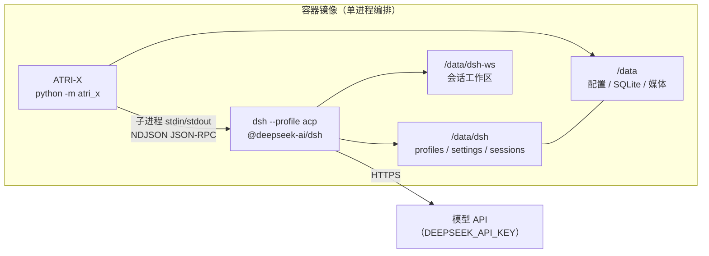

# 内置 DSH（DeepSeek Harness）ACP 编排

> 定位：**最小闭环**。本文描述现在能跑通的部分：镜像内置 DSH、ATRI-X 侧纯标准库 ACP
> 客户端、`session/new → prompt → usage → close` 的闭环冒烟。路由阈值、上下文交接、
> 预算记账尚未接入对话链路，列在文末「后续」。

## 1. 为什么是 ACP

DSH 提供四种编程接入面（headless 一次性任务、SDK JSON-RPC、ACP、web HTTP）。本仓库选 ACP：

| 需求 | ACP 的答案 |
|---|---|
| 多会话隔离且并发 | 一条 stdio 连接可同时跑多个独立会话 |
| 中途取消 | `session/cancel`（headless 只能杀进程） |
| 按任务选模型/推理强度 | `session/set_config_option(model \| reasoning_effort)`，只接受内核公布的取值 |
| 用量可观测（有限） | 协议里有 `usage` / `session/update.usage_update`，但当前内核对 `session/prompt` 只回 `stopReason`；没回报时按「不确定」记账 |
| 持久与回收 | `session/list` / `session/resume` / `session/close` |

边界（都是 DSH 当前实现的限制，不是选型失误）：不支持 `session/load`、删除、fork、
transcript 回放、客户端 fs/terminal 操作、mode/plan/commands；每个会话只有**一个主
workspace**（附加目录不支持）；同一会话同一时刻只允许一轮 prompt；只接受光栅提示词图片；
协议为 `0.2.0-rc.2`，无兼容承诺，因此镜像里**锁死精确版本**。

## 2. 组件



| 文件 | 职责 |
|---|---|
| `atri_x/agent/dsh/types.py` | 协议常量、异常、`AcpSession` / `AcpEvent` / `AcpPromptResult` / `AcpUsage`，以及 `session/update` 与 `usage` 的纯解析函数 |
| `atri_x/agent/dsh/transport.py` | 拉起子进程、NDJSON 帧收发、请求槽位、服务端请求分发、stderr 尾部、超时与进程退出 |
| `atri_x/agent/dsh/client.py` | `AcpClient`：`initialize` / `session new|resume|list|close` / `set_config_option` / `prompt` / `cancel` |
| `atri_x/agent/dsh/smoke.py` | `python -m atri_x.agent.dsh.smoke`：闭环冒烟，打印 stopReason、input/output/cache token 与上下文占用 |
| `tests/test_dsh_acp_client.py`、`tests/_dsh_fake_acp_server.py` | 离线测试（不依赖 Node/dsh）与可脚本化的假服务端 |

客户端**不参与启动装配**：导入 `atri_x.agent.dsh` 没有副作用，也不被 `atri_x/app/` 引用；
是否、何时拉起 DSH 由后续的路由模块决定。

## 3. 协议用法（客户端视角）

```python
from atri_x.agent.dsh import AcpClient

with AcpClient("dsh --profile acp", prompt_timeout=180) as client:
    session = client.new_session("/data/dsh-ws")           # 绝对 cwd
    client.set_config_option(session.session_id, "model", "deepseek-v4-flash")
    result = client.prompt(session.session_id, "问题文本")
    print(result.stop_reason, result.usage.to_dict(), result.text)
```

- 事件流：`session/update` 的 `agent_message_chunk` / `agent_thought_chunk` / `tool_call` /
  `tool_call_update` / `usage_update` 被收敛成 `AcpEvent`，既进 `result.events`，也走
  `AcpClient(on_event=...)` 回调（读线程调用，必须快速返回）。
- 停止原因：`end_turn` / `max_tokens` / `max_turn_requests` / `refusal` / `cancelled`；
  非 `end_turn` 一律视为未成功。
- 错误：JSON-RPC 错误映射成 `AcpError(code, message)`；子进程退出/管道破裂是
  `AcpProcessError`（带 stderr 尾部）；超时是 `AcpTimeoutError`，`prompt` 超时会先发
  `session/cancel` 再抛。
- 并发保护：同一会话已有 prompt 在途时再次 `prompt` 直接报 `AcpError`，可用
  `has_prompt_in_flight()` 先查。

## 4. 安全默认

| 面 | 做法 | 原因 |
|---|---|---|
| 权限请求 | `session/request_permission` **默认拒绝**（优先选 `reject_*` 选项，否则 `cancelled`），只能通过 `on_permission` 显式放行 | 自动 allow 等于绕过 ATRI-X 自己的风险确认流程 |
| 工具面 | 部署侧用 profile 的 `cordis.patch.yml` 关掉 shell / 写文件工具，只留只读能力 | DSH 默认带 bash/fs/web 工具，群聊场景等于提示注入 RCE |
| 进程 | stdio 子进程，不开端口 | 不需要为 DSH 暴露任何网络入口 |
| 状态 | `DSH_HOME` / 工作区都在 `/data` 卷，跟 ATRI-X 数据同卷 | 备份、迁移、升级口径统一 |

## 5. 镜像与运行

- Dockerfile 的 `dsh-runtime` 阶段用 `node:24-bookworm-slim` 装
  `@deepseek-ai/dsh@${DSH_VERSION}`，构建期跑 `dsh --profile acp --dump-config`
  作为 fail-fast；运行阶段只拷 `node` 二进制与 dsh 包树（npm/pnpm 不进镜像）。
- 构建参数：`NODE_BASE_IMAGE`、`DSH_VERSION`、`DSH_NPM_REGISTRY`（`.env` / compose /
  `deploy/build_push.py` 均支持）。
- 运行阶段固定 `apt-get install libstdc++6 ca-certificates`（node 二进制依赖）；
  `EXTRA_TOOLS` 语义不变（只增不减）。
- 环境变量：`DSH_HOME=/data/dsh`、`DSH_WORKSPACE=/data/dsh-ws`、
  `DSH_ACP_COMMAND="dsh --profile acp"`；模型凭据由 ATRI-X 注入（见 §6.4）。

### 5.1 Windows 原生包：内置内核（不依赖外部 `dsh`）

容器外的形态没有包管理器。`packaging/assemble_kernel.py` 从**本机已装好的 DSH**
（DSH 桌面端 / CLI 的 `node_modules`）组装一份自包含内核到 `runtime/dsh-kernel/`：

1. `node <dsh>/lib/bin.js --profile acp --dump-config` 取 acp profile 真实引用的包名；
2. 按 `dependencies` 求闭包，剪掉 `@deepseek-ai/dsh-client-*` / `dsh-web*` /
   `dsh-host-frontend-static*`（ACP 用不到）；
3. 拷 `node.exe` + 依赖闭包，写 `kernel.json` 清单；
4. **核验**：用产物自己的 node 起 ACP 服务端、发 `initialize`、读回 `result`；启动期
   报 `Cannot find module` 就从源目录补拷该包后重试（自动补拷，实测 2 轮 / 23 个包）；
5. 产物 `verified: true` 写进清单，`python -m atri_x.sidecar verify --acp` 可复验。

运行期解析在 `atri_x/sidecar/`：`ATRIX_DSH_KERNEL`（显式目录）→ `ATRIX_RUNTIME_DIR`
（运行时根）→ `<发行包>/runtime` → `<配置目录>/runtime`；找到就返回
`[node.exe, bin.js, --profile acp]`，找不到回退 `dsh --profile acp`。
`atri_x/agent/dsh/smoke.py` 的命令解析顺序是「显式 `--command` > `DSH_ACP_COMMAND` >
内置内核 > PATH 上的 `dsh`」，因此内置内核优先、无需外部安装。

前提与边界：

- 组装**需要一次联网/一台已装 DSH 的机器**（脚本只读源 `node_modules`，不跑 npm）；
- 内核与 DSH 版本绑定（`kernel.json` 里的 `dshVersion`），升级 DSH 后要重新组装；
- 体积：node.exe ~93 MB + 依赖闭包 ~189 MB（剪枝后 384 包）；
- 这是「运行 ACP 的运行时」；把它接进对话路由是 §6 的内容（**已实现**），内核本身不感知路由。

冒烟：

```bash
# 宿主机/镜像内均可，需要能启动 dsh 且配好 DEEPSEEK_API_KEY
python -m atri_x.agent.dsh.smoke --json
python -m atri_x.agent.dsh.smoke --show-events --model deepseek-v4-flash --prompt "解释 ACP"
# 容器内（镜像 ENTRYPOINT 已含 python -m atri_x，必须覆盖 entrypoint）：
# docker compose run --rm --entrypoint python atri-x -m atri_x.agent.dsh.smoke --json
# 直接指向安装位置（dsh 不在 PATH 时）
DSH_ACP_COMMAND="node /usr/local/lib/node_modules/@deepseek-ai/dsh/lib/bin.js --profile acp" \
  python -m atri_x.agent.dsh.smoke
```

冒烟打印的 `tokens: input=… output=… cachedRead=…` 直接来自 `session/prompt` 的
`usage` 字段；当前内核**通常不回**这个字段，所以常见输出是全 0 —— 那是"没有信号"，
不是"这次调用不要钱"（记账口径见 §6.3）。

## 6. 深度路由（已实现）

DSH 已经被接进对话链路：**普通聊天走 ATRI-X 原生低成本链路，只有"够复杂"的一轮才
一次性交给 DSH**。挂点在 :func:`atri_x.agent.chat_llm.call_llm`：请求 hook 跑完、媒体
解析完、调原生模型之前问一次路由（``allow_route`` 只在**一轮的第一次调用**为真；工具
轮次与视觉重试不会再换后端）。

| 文件 | 职责 |
|---|---|
| `atri_x/agent/dsh/command.py` | 启动命令解析：显式 > `DSH_ACP_COMMAND` > 内置内核 > PATH 上的 `dsh`（冒烟与路由共用） |
| `atri_x/agent/dsh/router.py` | 任务特征打分 + 成本闸门 + 熔断（`[agent.dsh]`，纯函数可离线断言） |
| `atri_x/agent/dsh/handoff.py` | **上下文交接**：系统设定 + 最近 N 轮 + 当前消息拼成一次性 prompt；ACP usage → 账本 `Usage` |
| `atri_x/agent/dsh/runtime.py` | 长驻 `AcpClient` + 子进程环境收敛（凭据注入）+ 每次路由一个一次性会话 + asyncio/阻塞桥接 + 串行化 |
| `atri_x/agent/dsh/route_call.py` | 接进 `call_llm`：凭据解析、预算预占/结算、流式回传、成功/失败/部分输出、熔断提示 |
| `atri_x/agent/dsh/status.py` | `python -m atri_x.agent.dsh.status [--json] [--score 文本]`：内核/可用性/熔断/打分标定 |

### 6.1 判定：特征打分 + 成本闸门 + 熔断

```
score = 0.15·长度 + 0.20·(代码痕迹+标识符) + 0.15·路径/文件名
      + 0.30·任务动词 + 0.10·多步要求 + 0.10·求解型问句 − 0.30·寒暄（短句）
effective     = score − λ·cost_pressure
cost_pressure = (cost_ratio−1)/cost_ratio · min(1, est_tokens/cost_scale_tokens)
```

- `score >= min_score` 且 `effective >= min_score` 才路由（默认 `min_score=0.40`、
  `λ=1.0`、`cost_ratio=2.0`、`cost_scale_tokens=20000`；配置见 `[agent.dsh]`）；
- **熔断**：连续失败 `circuit_breaker_failures` 次后打开，冷却
  `circuit_breaker_cooldown_seconds` 后半开重试；打开熔断/首次失败才提示用户一次；
- **不可用静默降级**：没有内核、没有 `dsh` 命令、低于阈值、冷却中都回原生链路，
  不影响聊天（`status` 子命令能看到原因）；
- 打分样例（`--score` 可复现原始分）：寒暄/天气 ≈0，`解释一下 ACP 协议` ≈0.11，
  `写一个 Python 脚本，读取 data.json，统计订单并导出 CSV` ≈0.53，
  `重构 utils.py 里的 parse 函数并补测试` ≈0.47。

### 6.2 上下文交接（无状态）

`session/resume` 不回放历史，所以交接内容由 ATRI-X 自己拼：**每次路由新开一个 DSH
会话、发一条一次性 prompt、拿到结果就关**。prompt = 系统设定 + 最近
`max_history_messages` 轮 + 当前用户消息，总长受 `prompt_char_budget` 约束（超了从最旧
的历史开始丢并在 prompt 里注明）。好处是路由轮次与非路由轮次混排不会串上下文，失败重试
也不需要迁移状态；代价是每轮重新带一点历史（默认保守值，见配置注释）。

`[agent.dsh].model` / `reasoning_effort` 会经 `session/set_config_option` 下发给内核，
而内核**只接受它自己公布的取值**（复合值，例如 `deepseek/deepseek-v4-flash`）。可以用
`python -m atri_x.agent.dsh.status` 或内核公布的可配置项确认；填成裸模型 id（例如
`deepseek-v4-flash`）时内核回 `AcpError [-32602] unknown model option`，此时 ATRI-X
**降级为内核默认模型继续跑完本轮**（不再每轮硬失败、也不会把熔断刷开），并在审计
`dsh_route_succeeded` 的 `warnings` 属性里记一条说明。同一进程内失败过的覆盖不再重试，
两者独立降级。

### 6.3 预算记账

命中路由时走**既有**的预算服务：

1. 调用前 `agent.begin_chat_budget(...)`（硬限制生效时原子预占；费用硬限制需要给
   `[agent.dsh].model` 配价格，否则这次路由会被拒绝并静默走原生）；
2. 结束后，**只有内核真的回报了 `usage`** 才把它交给 `agent.settle_chat_budget(...)`
   结算；内核没回报（当前默认情况）时传 `None`，于是 `budget_ledger` 走既有的
   「保留预占金额 + 标记 uncertain + 审计 `chat_budget_uncertain`」分支 —— 硬额度仍然
   按预占消耗，绝不会出现"内核不回 usage ⇒ 实际用量记 0 ⇒ 硬额度永不消耗"；
3. 计费用模型是 `[agent.dsh].model`（为空则沿用本轮原生模型）；没有硬预占时走
   `agent.record_chat_usage(...)` 记软用量，但**没有真实 usage 就跳过**（不记假数）。

`AcpPromptResult.usage_reported` 是这个判断的出处：响应里真的存在 `usage` 字段才为真，
`AcpUsage` 的字段缺失仍然按 0 解析（不猜语义）。

失败语义：一个字都没输出就失败 → 回退原生（用户只看到正常回答）；已经流出了部分文本 →
保留部分内容收尾并提示，不重放、不双写。

### 6.4 凭据注入与环境收敛

子进程的凭据有两个来源问题要一起解决：

- **DSH 侧**的 `dsh-credentials-local` 解析顺序是「继承的环境变量 > `DSH_HOME` 下的
  `.credentials.yaml` > 会话 cwd 的 `.env` > `DSH_HOME` 的 `.env`」，内核的
  `dsh-llm-deepseek-api-key` 默认找 `DEEPSEEK_API_KEY`；
- **ATRI-X 侧**的密钥可能只在配置目录的 `.env` 里（Windows 图形端把密钥写进
  `%APPDATA%\ATRI-X\.env`），而读 `.env` 的代码从不回写 `os.environ`，所以
  "子进程自己继承"这条路拿不到值，内核报 `MISSING_CREDENTIAL`。

因此 `DshRouteService.ensure_runtime` 用 `resolve_credential_env` 从 `agent.providers`
里取出 ATRI-X 已经解析好的 `api_key`（`[agent.dsh].credential_provider` 指定用哪个
provider，空则优先名字含 `deepseek` 的 provider、其次当前 work provider），把
`DEEPSEEK_API_KEY`（`credential_env` 可改）与需要时的 `DEEPSEEK_BASE_URL`
（`credential_base_url_env`，仅当 `base_url` 不是官方 `api.deepseek.com` 时）交给
`DshRuntime(extra_env=...)`。

同时做**环境收敛**（纵深防御）：`DshRuntime._ensure_client` 不再无脑
`dict(os.environ)`，而是用 `atri_x.processenv.Environment.without_sensitive_keys()`
滤掉 `*_KEY` / `*_TOKEN` / `*SECRET*` 之类的继承变量，再叠回上面那一个明确要注入的凭据，
最后以 `isolate_env=True` 起子进程（`JsonRpcStdio` 只用这份环境，不再往里补继承项）。
ATRI-X 侧解析不到密钥时不注入空值，退回继承值（`.credentials.yaml` / 宿主环境仍可用）。

### 6.5 仍未做（可选）

1. **工具回灌**：把 ATRI-X 的工具以 Streamable HTTP MCP 暴露给 DSH，让风险确认与预算
   仍由 ATRI-X 裁决。当前 DSH 使用自带工具，权限请求默认拒绝
   （`[agent.dsh].allow_permissions=false`），群聊场景不建议打开。
2. **profile 加固**：只读工具的 `cordis.patch.yml` 与 persona 覆盖写进镜像资产，
   避免群聊里出现“编码助手”口吻。
3. **跨重启熔断状态持久化**：当前熔断是进程内的；用量本身已经落预算账本。
4. **真实 usage**：内核开始回报 `usage` 后（`usage_reported=true`），结算与日报口径自动
   回到精确值，不需要再改代码。

## 7. 验证

```bash
python -m unittest tests.test_dsh_acp_client tests.test_dsh_route -v   # 离线，77 个用例
python -m atri_x.agent.dsh.status --score "重构 utils.py 并补测试"     # 内核+路由状态
python scripts/check_syntax.py
python scripts/check_imports.py
python scripts/check_integration.py
```
