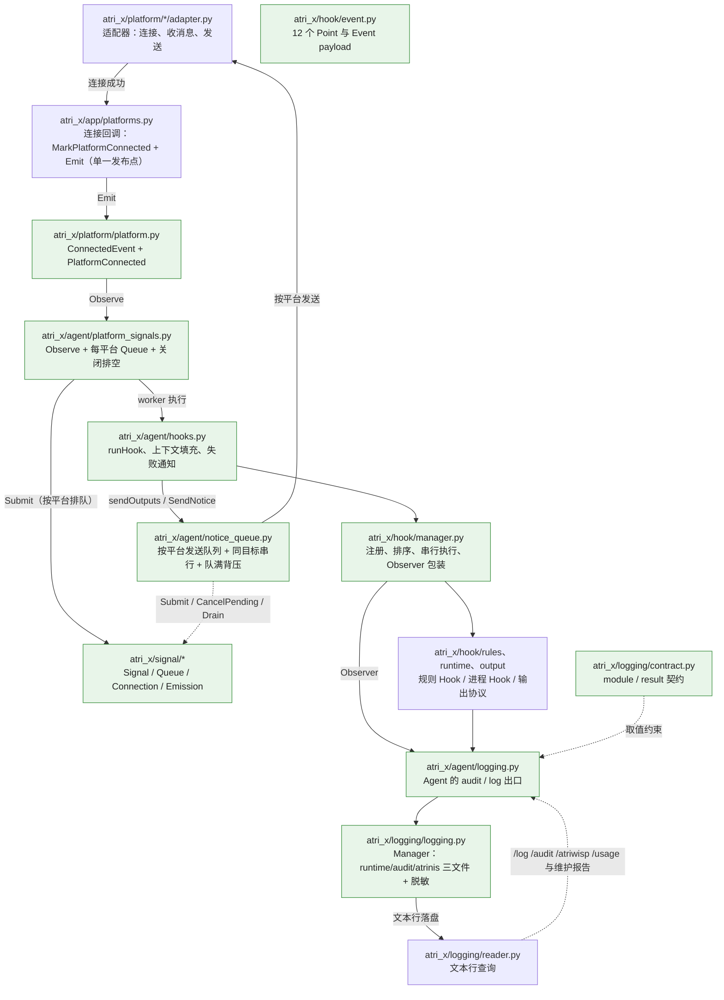

<!-- locator:signals -->
# 信号与日志边界

本文是 fork 侧"信号与日志谁负责什么"的唯一出处。

上游有一份同名文档 `devdocs/signals-and-logging.md`，但上游那套实现（九字段 `LogRecord` + 全局
`LogSubmitted` 信号 + `internal/events`）**fork 不采用**，所以本文写的是 fork 现在的真实边界，以及
每条边界为什么是这样。要看上游版本：`git show refs/remotes/upstream/main:devdocs/signals-and-logging.md`；
与上游的差异清单与理由见 [`upstream-sync-todo.md`](upstream-sync-todo.md) §8 与
[`upstream-changelog-cross-check.md`](upstream-changelog-cross-check.md)。

## 1. 现状：两条独立设施，不要混为一谈

| 设施 | 位置 | 是什么 | 谁在用 |
| --- | --- | --- | --- |
| 通用类型化信号 | `atri_x/signal/` | `Signal[T,R]` + 每个信号独立的队列 / 容量 / 并发上限 / 同 key 串行 / 超时 / 关闭策略；**零 `internal/*` 依赖** | `platform.PlatformConnected` 的订阅，以及通知的按平台发送队列 |
| Hook 点 | `atri_x/hook/` | 12 个稳定边界，规则与插件 Handler 按优先级**串行**执行，可返回可编辑字段与输出意图 | 规则 Hook、进程 Hook、内置 Hook（含 `builtin.cron.missed_once`） |

**同一件事只允许走其中一条**：可以被改写的业务边界走 Hook；只读的进程级事实走信号。
把"要改写的边界"做成广播，调用方就拿不回结果；把"只读事实"做成 Hook 点，就会把一个消费者
的耗时压进发布方（这正是 `platform.connected` 之前的毛病，见 §7）。

## 2. 处理链路与文件职责

## 3. 表一：信号所有权与依赖边界

| 所有者 | 职责 | 不做什么 |
| --- | --- | --- |
| `atri_x/signal` | 类型化信号、连接、每信号独立队列、背压、超时、同 key 串行、断开与排空 | 不认识业务、日志、配置或存储；不引入任何 `internal/*` |
| 事实的**定义方** | 声明信号与 payload 类型（例如 `atri_x/platform` 定义 `ConnectedEvent` + `PlatformConnected`） | 不持有消费者、不排队、不重试 |
| 事实的**发布方** | 直接 `Emit`（连接事实经 `atri_x/app/platforms.py` 的单一发布点） | 不等消费者业务跑完；不关心有没有订阅者 |
| **订阅方** | 自己 `Observe` / `Connect`，自己持有队列、并发上限与关闭 | 不要求发布方为它排队；不从别的消费者转发拿到事实 |
| `atri_x/hook` | 可改写边界：注册、排序、串行执行、Observer 包装 | 不做进程级广播；不直接发平台消息 |
| App（`atri_x/app`） | 服务装配、启动与关闭编排（30 秒预算） | 不替消费者排队；不把事实转给某个具体消费者；不决定是否通知用户 |
| `atri_x/logging` | 三个日志文件的写入、轮转、保留、脱敏；文本行查询 | 不判断业务结果；不从错误链反推结果 |

## 4. 表二：必须同步完成 vs 可以广播

| 场景 | 结论 | 在 fork 里的落点 |
| --- | --- | --- |
| 权限 / 角色 / 额度裁决 | **必须同步**，结果就是本轮结论 | `atri_x/security`、`atri_x/ratelimit.py`、群策略 |
| 可改写 Hook | **必须同步**：改出来的 `message.segments` / `llm.*` 要立刻参与本轮 | `atri_x/hook/manager.py` 串行执行 + `atri_x/agent/hooks.py` |
| 工具风险确认、追加确认等待 | **必须同步**：等的是用户下一步输入 | `atri_x/turn` 的 Phase + `AwaitRiskConfirmationContext` / `AwaitAppendExpiration` |
| Usage 记账 | **必须同步**：写完才进入下一步统计 | `atri_x/agent/context_usage.py` 的 `recordUsage` |
| Session / `state.toml` 关键持久化 | **必须同步**：失败要让调用方知道 | `atri_x/session`、`Agent.saveRuntimeState`（写前先 `mergeExternalRuntimeState`） |
| 日志落盘 | **异步**：不阻塞业务，失败只影响可观测性 | `atri_x/logging/logging.py` |
| 平台连接成功事实 | **广播**：消费者各自排队，发布方不等 | `atri_x/platform` → `atri_x/agent/platform_signals.py` |
| 通知 / 发送 | **同步但受限**：调用方仍等真实结果，但每个平台最多 8 条并发、256 条在等，同一目标串行，队满立刻返回错误（不是故障，是背压） | `Agent.SendNotice` → `atri_x/agent/notice_queue.py`（`signal.Queue`）→ 平台适配器 |
| Cron / Atrinis 报告 | 在本轮后台运行内同步准备，发送走 delivery | `atri_x/cron`、`atri_x/atrinis` |
| 模型重试 | 重试由客户端自己执行；面向用户的提示跟随真实调用，重试日志独立落盘 | `atri_x/llm` 的 `RetryNotifier` + `Agent.attachLLMRetryNotifier` |
| 媒体清理 | 后台并发（最多 4 个对象，按媒体 ID 互斥） | `atri_x/media` |

## 5. 日志侧边界

- **契约唯一出处**：`atri_x/logging/contract.py` 登记 `module` 与 `result` 的合法取值，
  `ValidLogModule` / `ValidLogResult` 是校验入口。**新增来源先登记**，避免出现拼写漂移的第二套命名。
- **等级与结果互相独立**：`level` 由掌握上下文的来源决定；`result` 表达业务事实
  （`succeeded` / `failed` / `canceled` / `rejected` / `skipped`）。读取方**不得**从 `result` 反推
  `level`，也不得从 `level` 反推 `result`——运行中定时任务的正常取消是 `canceled` + `INFO`，
  策略拒绝是 `rejected` + `WARN`。
- **审计有独立下限**：提高 `runtime.log_level` 不会停止审计记录，`/usage` 依赖的用量事实必须留下。
- **正文形态**：fork 用 `log/atri_x/logging/` 的单行文本（`key=value`，可解析），JSON 正文放 `body_json` 字段，
  raw 视图会缩进展开。**这是与上游 JSONL 原生 JSON 的关键差异**，也是"正文长度上限 / JSON 原生嵌入 /
  `--raw`"这些上游功能在 fork 上成本不同的原因。
- **脱敏**：`atri_x/redact` 是 fork 自加的，`atri_x/logging/logging.py` 对所有字符串与 error 属性
  统一脱敏。上游删掉了自己的脱敏正则（理由：本来就没记敏感信息），两边取向相反，fork 保留。

## 6. 新增一处信号时的检查单

1. 这个事实是"只读的进程级事实"，还是"某条业务链上要改写的边界"？后者用 Hook 点，不新增信号。
2. 定义方放在**掌握事实的模块**（平台连接事实就放 `atri_x/platform`），不要为了"通用"新开事件总线包。
3. 消费者自己排队：`Observe` 回调里只做准入与 `Submit`，业务跑在队列 worker 上；`Queue` 默认
   `Capacity=256 / Concurrency=1`（同 key 串行、不同平台互不排队）。
4. 关闭路径写全：先停止接纳（置 `closed` + `Disconnect`），再排空；超出预算返回 `ctx.Err()`，
   不宣称仍在跑的回调已经退出。**准入判断与队列创建、关闭共用同一把锁**（`Disconnect` 收不回已发出的快照）。
5. 订阅必须早于第一次 `Emit`——信号不缓存、不重放（`atri_x/app/integrations.py` 在适配器启动前订阅）。
6. 测试至少覆盖：发布方不被消费者业务阻塞、同 key 串行、关闭后不再接纳、重复启动幂等。

## 7. 已知的有意差异（不是缺陷）

| 差异 | 说明 |
| --- | --- |
| 不采用九字段 `LogRecord` | fork 的日志契约只有 `module` + `result`（`atri_x/logging/contract.py`），正文长度上限与 JSONL 落盘都不做 |
| 没有 `internal/events` | 进程级信号的定义跟着事实的归属走（目前唯一一处：`atri_x/platform`） |
| Cron 不独立订阅平台连接 | cron 仍挂在 hook 点 `builtin.cron.missed_once` 上，因此在 hook 侧的按平台队列里执行（上游让 Cron 自己订阅、自己排队） |
| 发布点是 App 里的单一回调 | 上游让每个平台适配器自己 `Emit`；fork 保留 `registerPlatformHooks` 的 notifier 作为唯一发布点，改动面更小 |
| 通知保持同步语义 | 上游的 `notification.Manager` 允许异步侧只确认接纳；fork 的调用方（命令回复、continuation、Hook 失败通知）靠返回的 `Receipt` / error 决定后续，因此队列只做并发上限、同目标串行与队满快速失败，**不改变调用契约** |
| 保留脱敏 | 见 §5 |
