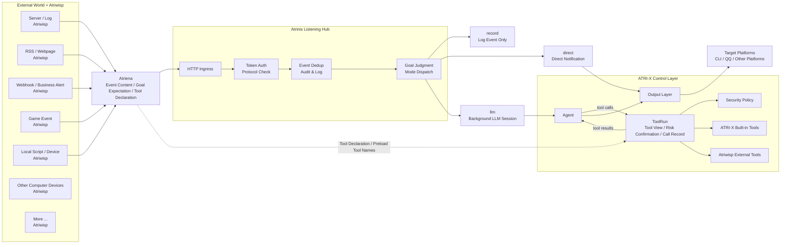

# Atrinis 监听枢纽

核心思想：

- 让 ATRI-X 掌控一切。
- 让 Atrinis 管理一切。
- 让 Atriwisp 观测一切。

Atrinis 是 ATRI-X 的事件监听枢纽。它像一颗恒星，接住来自各处 Atriwisp 群星的信号，再由 ATRI-X 决定是否记录、通知、分析或执行后台任务。

## 它解决什么问题

普通聊天机器人通常只会响应用户消息。Cron 可以响应时间，但不知道外部世界发生了什么。

Atrinis 让 ATRI-X 可以响应外部世界。

例如：

- 服务器异常时，让 LLM 分析日志并判断是否通知。
- RSS 更新时，自动总结内容并推送给目标平台。
- 游戏服务器产生事件时，让 ATRI-X 记录、通知或执行后台任务。
- Webhook 收到业务告警时，先交给 ATRI-X 判断严重程度。
- 本地脚本发现状态变化时，把结果送入 ATRI-X，而不是直接乱发消息。

简单说，Atrinis 把 ATRI-X 从“等用户说话的机器人”扩展成“能感知外部世界的 Agent 枢纽”。

## 架构图



## 媒体资源边界

Atriwisp 自己的文件由外部进程管理；Atrinis workspace 保存临时计算和普通工作文件。真正进入 LLM、持久化报告或 direct 平台输出的媒体由共享 Media Center 管理，使用 `media:<sha256>` 标识，不重复保留 direct 的 sandbox 下载副本。

Atriena v3 的 image/file segment 在 `url` 中填写 HTTP(S)、data URI 或完整 `media:<sha256>`，不新增独立 `media` 字段。Atriwisp 不获得媒体管理 RPC，外部工具也不会收到宿主导出文件。报告 outbox 使用稳定媒体来源，待重试引用独立于有限期的已发送缓存。详见 [媒体使用与清理](atrinis-usage.md#下载与存储)。

## 三个角色

### Atrinis（艾露妮斯）

Atrinis 是 ATRI-X 内部的事件入口 runtime，和平台 runtime、Cron runtime 同级装配。

它统一接收外部事件，把事件接到记录、通知或后台 LLM；它像一颗恒星，所有 Atriwisp 的信号都围绕它汇聚，但最终能量由 ATRI-X 控制。

Atrinis 负责：

- 接收 Atriena 事件请求。
- 校验 token 和协议字段。
- 按 `atriwisp.name + source + id` 持久化去重。
- 记录 Atrinis 日志和审计信息。
- 裁决事件可以投递到哪些平台。
- 按事件模式执行 `record`、`direct` 或 `llm`。

Atrinis 不是普通聊天平台，也不实现 PlatformAdapter。外部事件不能绕过 Agent、Tool Runtime、Security Policy 和 Output Layer。

### Atriwisp（艾露维丝）

Atriwisp 是外部子监听器。它可以是一个 shell 脚本、一个常驻进程、一个 RSS 轮询器、一个 Webhook 转发器、一个游戏服务器插件、一个日志监听器、一个硬件状态采集器，或者任何能把外部信号转换成 HTTP JSON 的程序。

它观察的“世界”不限定类型，包括但不限于：

- 操作系统事件。
- 文件和日志变化。
- 服务器状态。
- 游戏或业务服务事件。
- RSS、网页、Webhook。
- 数据库或队列消息。
- 设备、传感器或本地脚本输出。
- 任何计算机能接收、读取、监听或生成的内容。

Atriwisp 是 ATRI-X 的眼睛，也像散布在外部世界的探机。它们可以很多、很小、很分散；职责只有一个：把外部世界发生了什么告诉 Atrinis。

Atriwisp 只负责“看见并上报”。它不直接控制 ATRI-X，不直接向聊天平台发消息，也不决定最终是否调用 LLM 或工具。

### Atriena（艾露维娜）：事件协议

Atriena 是 Atriwisp 向 Atrinis 投递事件的 JSON over HTTP 协议。

它负责把“外面发生了什么”变成 Atrinis 能理解的统一事件：来源是谁、事件 ID 是什么、内容是什么、希望怎么处理、希望投递到哪里。


首期 endpoint：

```text
POST /atriena/v3/events
GET  /healthz
```

> `/healthz` 只在 Atrinis 启用后存在。ATRI-X 默认不启用 Atrinis，因此未启用时不能用 `/healthz` 判断 ATRI-X、模型 API 或 OneBot 是否正常。

## 事件会怎样被处理

Atrinis 收到事件后，会按 `mode` 决定处理方式。

| 模式 | 作用 | 适合场景 |
| --- | --- | --- |
| `record` | 只记录事件，不调用 LLM，不发送通知。 | 事件归档、接入测试、低优先级信号。 |
| `direct` | 按 Atrinis 裁决后的目标直接发送文本通知。 | 简单告警、外部系统已生成可读消息。 |
| `llm` | 进入后台 LLM Session，由模型分析后决定是否报告。 | 需要分析、归纳、判断或使用工具的事件。 |

`llm` 模式的 HTTP 请求会快速返回，实际处理由后台 worker 执行。LLM 最终需要返回结构化结果：

```json
{
  "completed": true,
  "need_report": true,
  "report": "result"
}
```

`need_report=true` 时，Atrinis 会按裁决后的目标发送 `report`。

## 查看 Atriwisp 日志

可以用 `/atriwisp` 查看 Atrinis/Atriwisp 事件日志。它读取 `atrinis-YYYY-MM-DD.log`，支持按 Atriwisp 名称、事件来源、事件 ID、模式和时间范围过滤。

示例：

```text
/atriwisp
/atriwisp server-watchdog -n 20
/atriwisp --source minecraft-main --mode llm --since 2h
```

## 与 Cron、Atriyph 和 Skill 的关系

| 能力 | 触发来源 | 作用 |
| --- | --- | --- |
| Cron | 时间 | 到点执行 direct 或 LLM 任务。 |
| Atrinis | 外部事件 | 接收 Atriwisp 投递的事件并分发处理。 |
| Atriyph | 任务文本 | 用结构化方式描述任务、步骤和约束。 |
| Skill | 可复用能力 | 把经验或代码沉淀成可被发现和调用的能力。 |

简单说：Cron 负责“什么时候做”，Atrinis 负责“外面发生了什么”，Atriyph 负责“任务怎么描述”，Skill 负责“能力怎么复用”。

## 创建 Atriwisp 辅助工具

工作模式下，超级管理员可以让 ATRI-X 使用内置工具 `atriwisp_creator` 辅助创建 Atriwisp。该工具会返回创建指南、Atriena 事件模板、Atrinis 配置片段、监听器脚手架、curl 测试命令和安全检查清单；真正写文件或运行命令仍由文件工具和 shell 工具处理。

如需参考现成的 Atriwisp 示例、协议文档和模板，可查看 [Atriwisp Showcase](https://github.com/Elfreese/elwisp-showcase)。

## 下一步：配置与使用

- [Atrinis 配置与使用](atrinis-usage.md)：启用 Atrinis、配置 Atriwisp 策略、发送 Atriena 请求，并了解请求字段和投递边界。

