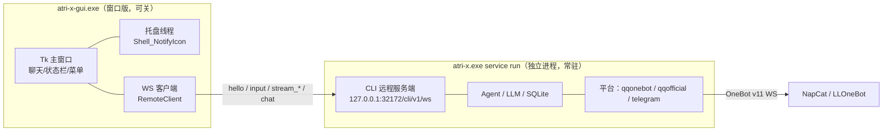

# Windows 桌面端与原生包（免安装 Python / Docker）

把 ATRI-X 打包成**本机可执行目录**，双击就是一个 Windows 桌面程序：聊天窗口 + 托盘常驻，
关掉窗口后台继续跑，接上 QQ OneBot 协议端后就是完整的群/私聊机器人。运行期仍然是纯标准库，
不需要装 Python、不需要装 Docker。

> 本页是"原生 exe / 桌面端"形态。想用 Docker Desktop 做容器化运维（备份/升级/回滚/健康接口），
> 用 [`deploy/windows/README.md`](../deploy/windows/README.md)；想部署到服务器，用
> [`deploy/README.md`](../deploy/README.md)。四种形态**共用同一份配置格式**，
> 换形态只需要搬 `app.toml` / `services.toml` / `state.toml` / `SOUL.md` / `.env`。

---

## 1. 形态与适用场景

| 形态 | 入口 | 适合 |
|---|---|---|
| **桌面端**（窗口版） | `atri-x-gui.exe` | 日常使用：聊天窗口、托盘常驻、开机自启、关窗口不退出 |
| 控制台 TUI | `atri-x.exe run` | 想要纯命令行、在 Windows Terminal 里看流式输出 |
| 后台服务 | `atri-x.exe service run` | 无人值守跑机器人（桌面端会自动帮你拉起） |
| 原生 exe（本页） | 拷目录即用 | 一台 Windows 机器上跑个人助理 / QQ 机器人 |
| Docker Desktop | [`deploy/windows/`](../deploy/windows/README.md) | 需要备份/升级/回滚/`/tasks` `/metrics` 运维接口 |
| Linux 容器 | [`deploy/README.md`](../deploy/README.md) | 多机、水平扩容、容器编排 |

> 不适合：需要多机/容器编排；需要 Docker 那套运维接口；需要无人值守的自动升级流水线。
> 构建细节、冻结后的技术限制见 [`packaging/README.md`](../packaging/README.md)。

### 1.1 桌面端的架构（关窗口为什么不掉线）



GUI **不是** Agent：它只是 `docs/frontend-api.md` 那套 WS 协议的一个前端。真正干活的是
`service run` 那个独立进程。所以：

- **关窗口 = 隐藏到托盘**，服务进程不受影响，QQ 机器人继续在线；
- 服务进程崩了不会拖垮窗口（界面显示「已断开」并自动重连）；窗口崩了也不影响机器人；
- 同一台机器上第三方前端（另一台设备、脚本、Web UI）也能连同一个服务端。

---

## 2. 构建

在**仓库根目录**执行（需要 Python 3.11+ 且带 `tkinter`，一次性装 PyInstaller）：

```bash
python -m pip install pyinstaller
python packaging/build.py
```

脚本会构建并**自己核验产物**（跑 exe 本体，而不是只看构建退出码）：

```
== ATRI-X windows packaging ==
python      : <Python 安装目录>\python.exe (3.14.7)
pyinstaller : 6.22.3
mode        : onedir
gui exe     : yes
dsh kernel  : no
artifact    : <仓库>\dist\windows\atri-x\atri-x.exe
size        : 40.1 MB in 50 file(s)
verify      : passed
```

想要**内置 DSH 内核**（目标机不用另装 Node/dsh）就先组装一次再打包：

```bash
python packaging/assemble_kernel.py --modules "C:\path\to\node_modules"   # 已装 DSH 的机器
python packaging/build.py --with-kernel                                    # 317.9 MB / 23862 个文件
```

产物：

```
dist\windows\atri-x\
├── atri-x-gui.exe      ← 双击这个：桌面端（窗口 + 托盘）
├── atri-x.exe          ← 控制台版：service run / doctor / config check / -m <模块>
└── _internal\          ← 运行时、tkinter、内置配置资产、可选的内置 DSH 内核
```

把整个 `atri-x` 目录拷到目标机器即可用（**不要只拷 exe**）。单文件模式
`python packaging/build.py --onefile` 只有控制台版（15 MB 左右，首启慢、杀软误报更多，
且启动时要解压到 `%TEMP%`，**TEMP 不可写时直接起不来**）。

---

## 3. 第一次启动（桌面端）

```bash
dist\windows\atri-x\atri-x-gui.exe
```

首次启动会发生三件事：

1. 在 `%APPDATA%\ATRI-X` 生成默认配置（**已存在就不覆盖**）：

   | 文件 | 作用 |
   |---|---|
   | `app.toml` | 行为、平台、工具、安全、维护等主配置 |
   | `services.toml` | `[providers.*]`、模型元数据、生图、视觉、语音 |
   | `state.toml` | 默认模式与模型（程序回写） |
   | `SOUL.md` | Agent 的 System Prompt |
   | `.env.example` | 环境变量模板，复制成 `.env` 后填密钥 |
   | `atrinis.toml` / `memories.toml` / `tool_tags.toml` | 外部事件入口、常驻记忆、工具标签 |
   | `plugins/` / `skills/` / `long_memory/` | Hook 插件、Skill、长期记忆目录（初始为空壳） |

2. 把 `app.toml` 的 `[platform.cli.server].enabled` 置为 `true`（**只改这一行**，写前留
   `app.toml.bak`，写完用 `tomllib` 重新解析校验）；在配置目录 `.env` 里写入本机登录
   token `ATRIX_CLI_LOCAL_TOKEN=<随机值>`（已有 token 或环境变量则复用，幂等）。
3. 后台拉起 `atri-x.exe service run`（日志在 `%APPDATA%\ATRI-X\gui\service.out.log`），
   然后用 WS 连上去。探测到 `127.0.0.1:32172` 已经有服务在跑时**不会重复启动**，直接复用。

三步把它变成"能说话"：

1. `services.toml` 里给 provider 配 `api_key_env`（变量名），例如 `DEEPSEEK_API_KEY`；
2. 把密钥放进系统环境变量，或复制 `.env.example` 为 `%APPDATA%\ATRI-X\.env` 后填；
3. `state.toml` 里选默认模式与模型，或在聊天框里用 `/model` 切换。

验收：

```bash
dist\windows\atri-x\atri-x.exe doctor --no-model
```

期望 `[config] check passed`、`[config] storage_writable passed`、
`[platform] configured passed`；`model_credentials` 在没填密钥时失败属正常。

---

## 4. 桌面端怎么用

| 位置 | 行为 |
|---|---|
| 左侧会话栏 | 历史会话列表（当前会话带 `●`）；双击/回车切换会话，`刷新`/`新建` 按钮，`F5` 刷新 |
| 聊天区 | 用户消息、助手回复、推理过程（灰色）、通知（橙色）、错误（红色）分区显示；流式输出实时刷新 |
| 输入框 | `Enter` 发送、`Shift+Enter` 换行、`Tab` 触发补全（`/model`、`/help` 等） |
| 状态栏 | 左边是连接状态（已连接/连接中/已断开/鉴权失败），右边是运行状态（阶段 · 耗时 · 模型 · tokens） |
| 菜单 → 文件 | 新建会话、刷新会话列表、复制全部记录、退出（后台继续）/ 退出并停止服务 |
| 菜单 → 服务 | 重新连接、启动/确认后台服务、停止后台服务（强制）、打开配置目录、打开后台日志 |
| 菜单 → 帮助 | 关于、托盘/后台说明 |
| 点窗口 ✕ | **隐藏到托盘**，服务继续跑；没有托盘时退化为"关闭窗口（服务仍在）" |
| 托盘图标 | 左键/双击 = 显示窗口；右键菜单：显示 / 新建会话 / 重新连接 / 打开日志 / 退出 / 退出并停止服务 |

### 4.1 会话列表与历史

左侧边栏列出本客户端能看到的会话，双击（或选中后回车）**切换过去**：

1. 界面发一条 `/resume <session_id>` 命令 —— 复用服务端既有的 `/resume`：权限、
   审计、命名、上下文切换全部由 ATRI-X 自己处理，GUI 不另写一套；
2. 同时请求该会话的 `history`（只读帧，见 `docs/frontend-api.md` 的「扩展帧」），
   把用户/助手消息灌进聊天区（工具与系统的中间消息不回放）；
3. `新建`（或 `Ctrl+N`）发 `/new` 建新会话并刷新列表。

连上后台服务时会自动拉一次会话列表；断线时列表清空。历史记录来自服务端数据库，
不是 GUI 本地缓存 —— 所以换一台前端连同一个服务端也能看到同样的会话。

**「退出」与「停止服务」是两件事**：

- 退出（托盘/文件菜单）只关窗口，`service run` 继续跑，QQ 机器人不掉线；
- 「停止后台服务（强制）」会中断当前任务、机器人掉线。Windows 上没有"给另一个控制台
  进程发 Ctrl+C"的可靠办法，所以这里是 `taskkill`；需要优雅停机时请在控制台里
  `Ctrl+C`（用 `atri-x.exe service run` 手动起的场景）。

窗口位置会记在 `%APPDATA%\ATRI-X\gui\window.json`；窗口版是单实例，重复双击会**把已有
窗口提到前台**。

> 想要纯命令行：`atri-x.exe run`（本地 TUI，需要真终端；双击会开 cmd 窗口，建议用
> Windows Terminal 打开该目录再跑）。

---

## 5. 接 QQ（OneBot v11）

ATRI-X 是 OneBot v11 的**正向 WebSocket 客户端**：它主动连协议端的 WS 服务端。
所以 QQ 侧只需要一个协议端，ATRI-X 这边**不改代码**。

### 5.1 起协议端（以 NapCat 为例）

NapCat 基于 NTQQ 客户端，Windows 上原生支持，自带 WebUI：

1. 安装并启动 NapCat，按提示用手机 QQ **扫码登录**（这一步的登录态要一直保持）；
2. 打开 WebUI（默认 `http://127.0.0.1:6099/webui`，token 在启动日志或
   `webui.json` 里）；
3. 在"网络配置"里新建 **WebSocket 服务端**（正向 WS），示例端口 `3001`，
   建议设一个 `token`，并勾选"保存时启用"；
4. 确认端口可访问（浏览器直接访问 `http://127.0.0.1:3001` 会有响应）。

> 其他 OneBot v11 实现同理（LLOneBot 等），只要是**正向 WS 服务端**即可。
> 注意：这些都基于 NTQQ 的非官方 hook，存在**账号风控/封禁风险**；建议用小号，
> 不要拿主号做实验。合规路线是项目内置的 `[platform.qqofficial]`（QQ 官方机器人）。

### 5.2 打开 ATRI-X 的 OneBot 平台

编辑 `%APPDATA%\ATRI-X\app.toml`，把默认注释掉的这段打开：

```toml
[platform.qqonebot]
enabled = true
# 协议端的实际端口：NapCat 上面配的 3001；ATRI-X 默认值是 6700，两者对齐即可
ws_url = "ws://127.0.0.1:3001/"
# 协议端设了 token 才需要下面这行；值填进系统环境变量或 .env
access_token_env = "QQONEBOT_ACCESS_TOKEN"
# 群里被 @、被回复之外，消息里带这些词也会唤醒
trigger_keywords = ["atri"]
send_file_mode = "base64"        # 跨机器安全；同一文件系统可用 file_uri
inbound_dedup_enabled = true     # 断线重连不会把旧消息重放给模型
```

`.env`（或系统环境变量）里放：

```bash
QQONEBOT_ACCESS_TOKEN=协议端那个 token
```

**群里的触发规则**：默认只响应 `@机器人`、`回复机器人消息`、或含 `trigger_keywords`
的消息；群策略里可改成 `all`（全回）/ `keyword` / `reply` / `off`。私聊默认全回。

### 5.3 先冒烟，再上线

不要一上来就开桌面端然后盯着聊天窗等回复——先按协议层验一遍：

```bash
# 只验证连接 + get_login_info
dist\windows\atri-x\atri-x.exe -m atri_x.platform.qq_onebot.smoke --json

# 验证发送通道（往指定群发一条测试文本）
dist\windows\atri-x\atri-x.exe -m atri_x.platform.qq_onebot.smoke ^
    --url ws://127.0.0.1:3001/ --group 123456 --text "连通性测试" --json

# 验证事件推送方向（监听 20 秒，期间在群里 @ 一下机器人）
dist\windows\atri-x\atri-x.exe -m atri_x.platform.qq_onebot.smoke --listen 20
```

期望看到（样例，假协议端的输出形状与真实协议端一致）：

```
[qqbot] connecting: ws://127.0.0.1:3001/ (token=yes)
[qqbot] connected: self_id=10001 nickname=bot
[qqbot] sent group 123456 message_id=42
[qqbot] event: post_type=message type=group group=123456 user=20002 text=hello
{"ok":true,...,"event_count":1}
```

`--json` 的最后一行是结构化结果：`ok` / `self_id` / `nickname` / `sent` /
`event_count` / `events`。这一步通了，才说明"连得上、发得出、收得到"。

### 5.4 启动

改完 `app.toml` 后重启桌面端（或「服务 → 重新连接」）。在群里 `@机器人 你好` 试一句。
回复不出来时按 §11 的顺序排查：先确认冒烟通过，再确认模型密钥/模型名（`doctor`），
最后才看群策略与触发词。

---

## 6. 开机自启

两种方式，效果一样（都是当前用户级、不需要管理员）：

```bash
# 方式一：桌面端自带的开关（写 HKCU\...\Run，值为 atri-x-gui.exe --minimized）
atri-x-gui.exe --enable-autostart
atri-x-gui.exe --autostart-status
atri-x-gui.exe --disable-autostart

# 方式二：安装时顺便打开（安装包里「开机自启」任务是默认勾选的）
atri-x.exe -m atri_x.dist.install install --autostart
# 或直接用安装包：ATRI-X-<版本>-setup.exe（默认勾选「开机自动启动」）
```

自启动的命令带 `--minimized`：开机后窗口**不弹出来**，直接进托盘，后台服务照常拉起。
想取消就用同上的 `--disable-autostart`（或安装器的卸载流程会自动清理）。

> 自启指向的是**当前这个 exe 的绝对路径**。把整个目录搬到别处之后要重新开一次自启。

---

## 7. 安装 / 卸载

不想每次进目录双击，就装进用户目录（开始菜单 + 桌面快捷方式 + 「应用和功能」卸载项）：

```bash
# 安装到 %LOCALAPPDATA%\ATRI-X\app（把整个发行包复制过去）
dist\windows\atri-x\atri-x.exe -m atri_x.dist.install install --autostart

# 只看计划，不落盘
dist\windows\atri-x\atri-x.exe -m atri_x.dist.install install --dry-run

# 看装在哪、快捷方式是否存在
dist\windows\atri-x\atri-x.exe -m atri_x.dist.install status --json

# 卸载（默认保留 %APPDATA%\ATRI-X 的用户数据；连数据一起删要显式 --purge-data）
dist\windows\atri-x\atri-x.exe -m atri_x.dist.install uninstall --yes
dist\windows\atri-x\atri-x.exe -m atri_x.dist.install uninstall --yes --purge-data
```

| 选项 | 说明 |
|---|---|
| `--target DIR` | 自定义安装目录 |
| `--no-desktop` | 只建开始菜单快捷方式，不建桌面 |
| `--autostart` | 安装后顺手开自启 |
| `--add-path` | 把安装目录加进**用户** PATH（命令行里直接敲 `atri-x`） |
| `--force` | 目标目录非空也覆盖（升级用） |
| `--keep-app` / `--purge-data` | 卸载时保留程序目录 / 连用户数据一起删 |

安装器只写 `HKCU` 与用户目录，不动 `HKLM` / `Program Files`，不需要管理员权限。
源码运行（未冻结）时它**不复制代码**，只写一个开发版启动器，方便本地验证。

### 7.1 安装包（Inno Setup，推荐给普通用户）

普通用户不需要先解压 zip 再跑命令，直接发一个安装包：

```bash
# 构建（先有 dist/windows/atri-x；ISCC 查找顺序见 packaging/README.md §7）
python packaging/build_installer.py
python packaging/build_installer.py --verify          # 静默安装/卸载自检
python packaging/build.py --with-kernel --installer   # 构建 + 打包一条龙
# 产物：dist/installer/ATRI-X-<版本>-setup.exe
```

安装包做的事：把整个 `dist/windows/atri-x` 装到 `%LOCALAPPDATA%\ATRI-X\app`，建开始菜单
快捷方式（桌面图标可选），默认勾选「开机自动启动」（写 HKCU `Run\ATRI-X`，
`atri-x-gui.exe --minimized`），并在 `{app}\install.json` 里写
`"installer":"inno"` 标记。

| 行为 | 说明 |
|---|---|
| 卸载 | 「设置 → 应用」里的 `ATRI-X`，或安装目录的 `unins000.exe`；卸载前会 `taskkill` 掉还在跑的 GUI/后台服务 |
| 用户数据 | `%APPDATA%\ATRI-X` **默认保留**；交互式卸载会问一次「是否同时删除用户数据」 |
| 与脚本安装的关系 | 检测到 `installer=inno` 后，`atri-x -m atri_x.dist.install uninstall` 会**拒绝**执行并提示用 `unins000.exe`（避免留下指向已删目录的卸载器）；确实要强删加 `--force` |
| 静默安装 | `ATRI-X-<版本>-setup.exe /VERYSILENT /SUPPRESSMSGBOXES /NORESTART /DIR=<目录> /MERGETASKS=!autostart,!desktopicon` |

实测（含内置内核的 317.9 MB onedir → 56.0 MB 安装包）：静默安装 40.7 s / 23865 个文件，
`atri-x.exe --version` 正常，静默卸载 13.6 s 且目录被清空。构建环境有两个坑（TEMP 必须在
本地盘、安装根路径要够短）写在 [`packaging/README.md`](../packaging/README.md) §7.1。

---

## 8. 内置 DSH 内核（可选）

ATRI-X 通过 ACP 调 DSH（`dsh --profile acp`）。默认会去找 PATH 上的 `dsh`；如果你不想在
目标机器上另装 Node + dsh，可以把内核**打进包里**：

```bash
# 在有 DSH 的机器上组装（只读源 node_modules，不跑 npm、不联网）
python packaging/assemble_kernel.py --modules "C:\path\to\node_modules"
# → runtime/dsh-kernel/{kernel.json, node/node.exe, node_modules/...}

# 打包时带上（默认检测到 kernel.json 就自动带）
python packaging/build.py --with-kernel
```

组装脚本会**真启动一次 ACP 服务端并握手**，返回 `deepseek-harness-acp/...` 才算成功。
实测：384 个包 / 189.1 MB + `node.exe` 88.5 MB（合计 277.6 MB）；自动补拷 2 轮 peer
依赖后通过。

运行期可以随时查看/复验：

```bash
atri-x.exe -m atri_x.sidecar list            # 发现了哪些内置运行时
atri-x.exe -m atri_x.sidecar status          # 内置 DSH 内核的版本/路径/是否核验过
atri-x.exe -m atri_x.sidecar dsh-command     # 打印实际会用的启动命令
atri-x.exe -m atri_x.sidecar verify --acp    # 真跑一次 initialize 握手
atri-x.exe -m atri_x.agent.dsh.smoke         # 完整 ACP 冒烟（需要模型密钥）
```

- 想换/临时指定内核目录：设 `ATRIX_DSH_KERNEL=<内核目录>`；
- 想给别的位置的运行时：设 `ATRIX_RUNTIME_DIR=<运行时根目录>`（下面可有多个运行时）；
- 找不到内核时自动回退到 PATH 上的 `dsh --profile acp`，不会报错。

> 说明：内置内核解决的是"**运行时依赖**"；把 DSH 接进对话路由（成本闸门、上下文交接、
> 预算记账）见下面的 §8.1。设计细节在 [`devdocs/dsh-acp.md`](../devdocs/dsh-acp.md) §6。

### 8.1 深度路由：什么时候找 DSH

普通聊天仍然走 ATRI-X 原生低成本链路；只有**够复杂的一轮**才一次性交给 DSH。判定在
`atri_x/agent/dsh/router.py`：任务特征打分（代码痕迹、文件路径、任务动词、多步要求…）
过阈值，且成本闸门 `score − λ·cost_pressure` 仍然达标才路由；连续失败会熔断一段时间，
任何失败都静默回退原生链路，聊天不会中断。

配置在 `app.toml`（默认值已内置，不配也能用）：

```toml
[agent.dsh]
enabled = true              # 总开关（找不到内核/命令时自动视为不可用，不报错）
min_score = 0.40            # 任务复杂度阈值 0..1，越大越保守
lambda_penalty = 1.0        # 成本闸门权重
cost_ratio = 2.0            # DSH 单轮成本相对原生链路的估计倍数
cost_scale_tokens = 20000   # 多大的上下文算"一次大调用"（成本压力归一化）
model = ""                  # 下发给 DSH 的模型（session/set_config_option；空=内核默认）
timeout_seconds = 180
max_history_messages = 8    # 交接多少轮最近历史
prompt_char_budget = 12000
allow_permissions = false   # 保持拒绝 DSH 的权限请求（群聊场景不要打开）
circuit_breaker_failures = 3
circuit_breaker_cooldown_seconds = 300
```

查看状态 / 标定阈值（不用起 Agent、不起子进程）：

```bash
atri-x.exe -m atri_x.agent.dsh.status
atri-x.exe -m atri_x.agent.dsh.status --json
atri-x.exe -m atri_x.agent.dsh.status --score "重构 utils.py 里的 parse 函数并补测试"
```

输出里有内核是否可用、实际启动命令、熔断状态，以及每条样例的分数/是否路由/原因
（`below_threshold` / `cost_gate` / `breaker_open` / `unavailable`）。DSH 的 token 用量
会计入**同一套**按用户/群/日的聊天额度（`[budget_limits]`、`/usage`、日报口径不变）。
注意：费用硬限制开启时，需要给 `[agent.dsh].model` 配置价格，否则这一轮会静默走原生。

---

## 9. 命令速查

| 命令 | 作用 |
|---|---|
| `atri-x-gui.exe` | 桌面端（窗口 + 托盘；`--minimized` 直接进托盘，`--selftest` 自检） |
| `atri-x.exe run` | 完整前台：本地 TUI + 已启用平台（含 OneBot）+ Cron |
| `atri-x.exe service run` | 无界面服务：headless 主平台 + CLI 远程服务端 + 已启用平台 |
| `atri-x.exe doctor [--no-model] [--json]` | 部署验收 |
| `atri-x.exe config check` | 配置自检 |
| `atri-x.exe -m atri_x.platform.qq_onebot.smoke` | QQ 协议层冒烟（连接/发送/监听） |
| `atri-x.exe -m atri_x.agent.dsh.smoke` | DSH ACP 冒烟（优先用内置内核） |
| `atri-x.exe -m atri_x.agent.dsh.status [--json] [--score 文本]` | DSH 内核 + 深度路由状态/打分标定 |
| `atri-x.exe -m atri_x.sidecar status\|verify --acp` | 内置运行时状态/核验 |
| `atri-x.exe -m atri_x.dist.install install\|uninstall\|status` | 安装/卸载/状态 |

> `-m <模块>` 是冻结包对 `python -m <模块>` 的等价支持（源码运行时两种写法都可以）。

---

## 10. 与 Docker 方案的取舍

| 维度 | 原生 exe（本页） | Docker Desktop（[deploy/windows](../deploy/windows/README.md)） |
|---|---|---|
| 前置条件 | 无（拷目录即用） | Docker Desktop + WSL2 + Python |
| 体积 | 40 MB（含内置内核 318 MB） | 镜像数百 MB + 卷 |
| 日常入口 | 桌面端窗口 + 托盘 | 容器 + 脚本 |
| 升级 | 整目录替换 / 安装器 `--force` | `upgrade` / `rollback` 脚本 |
| 备份/恢复 | 手工拷 `%APPDATA%\ATRI-X` | `backup` / `restore-verify` |
| 运维接口（`/tasks` `/metrics`） | 可用：设 `ATRIX_HEALTH_ADDR` 启健康服务端，设 `ATRIX_OPS_TOKEN` 才注册 `/tasks` `/metrics` | 开箱即用 |
| QQ OneBot | 直连本机协议端 | 容器内连宿主机/同网络服务，需注意 `127.0.0.1` 指向 |
| 适合 | 个人单机桌面使用 | 长期运维/多人共用 |

---

## 11. 已知限制与排障

**限制**

- **无代码签名**：SmartScreen 首次运行会提示（安装包同样没有签名）；正式分发需要签名证书。
- **没有自动更新**：重装覆盖（`install --force` / 新安装包）或整目录替换。
- **没有 Python 解释器**：exec 型 Hook、Go 源码 Skill 里 `python xxx.py` 之类会失败。
- **窗口版没有控制台**：诊断信息在 `%APPDATA%\ATRI-X\gui\service.out.log` 与弹窗里；
  要控制台输出请用 `atri-x.exe`。
- **托盘/自启**：原生 `Shell_NotifyIcon` + HKCU Run，验证环境为 Windows 10 + Tk 9.0；
  未在多个 Windows 版本/多账户上遍历。
- **内置内核与 DSH 版本绑定**：升级 DSH 后要重新 `assemble_kernel.py`。
- **安装包路径长度**：内置内核里有 190 字符以上的相对路径，安装根 + 191 必须 ≤ 260
  （MAX_PATH）。默认 `%LOCALAPPDATA%\ATRI-X\app` 没问题；profile 极深的环境请用
  `/DIR=` 指短路径。
- **DSH 深度路由**：默认拒绝 DSH 的权限请求，所以它只能用"不需要确认"的只读能力；
  费用硬限制开启时需要给 `[agent.dsh].model` 配价格，否则该轮静默走原生；
  熔断状态是进程内的（不跨重启）。
- **会话历史只读**：GUI 侧边栏能切换/查看历史，但删除、归档、重命名仍走 `/delete`、
  `/archive`、`/rename` 命令（GUI 没有对应按钮）。

**排障顺序**

1. 窗口标题栏/状态栏显示「已断开」→ 看 `%APPDATA%\ATRI-X\gui\service.out.log`，
   或手动 `atri-x.exe service run` 看控制台；
2. `atri-x.exe -m atri_x.dist.install status` —— 装在哪、快捷方式是否在；
3. `atri-x.exe config check` —— 配置本身是否合法；
4. `atri-x.exe doctor --no-model` —— 平台是否装配起来（应看到 `qqonebot`）；
5. `atri-x.exe -m atri_x.platform.qq_onebot.smoke --json` —— 协议层通不通；
6. 群里 `@机器人` 看日志（`%APPDATA%\ATRI-X` 下按天日志）—— 是否被唤醒、模型是否报错。

**Q：GUI 一直「连接中」/「已断开」。**
A：多数是后台服务没起来或 token 对不上。先手动跑 `atri-x.exe service run` 看控制台输出；
再检查 `app.toml` 里 `[platform.cli.server].enabled = true`、`.env` 里
`ATRIX_CLI_LOCAL_TOKEN` 的值与 `[platform.cli.server.tokens]` 指向的环境变量名一致。
点「服务 → 启动/确认后台服务」会重新准备配置并拉起服务。

**Q：关窗口后机器人还在回消息。**
A：这是设计行为（服务是独立进程）。要停就在托盘/菜单里「停止后台服务」或
「退出并停止服务」。

**Q：`atri-x-gui.exe` 双击没反应。**
A：先用 `atri-x-gui.exe --selftest` 看退出码（窗口一闪是正常的，自检不显示窗口）；
再确认这台机器有 `tkinter`（自编包）或换用 `atri-x.exe run` 控制台模式。

**Q：冒烟报 `connect onebot websocket: ...`。**
A：协议端没起、端口不对、或 token 不对。先用浏览器/`curl` 确认协议端端口活着，
再核对 `ws_url` 与 token。

**Q：能连上，但群里不回。**
A：默认要 `@机器人`、回复机器人消息、或带触发词；再看群策略 `response_mode` 是否
被设成了 `off`；最后看模型密钥与余额（`doctor` 的 `model_credentials`）。

**Q：日志里同一条消息处理两次。**
A：`inbound_dedup_enabled` 默认开启；如果关掉了，协议端重连会重放消息。
