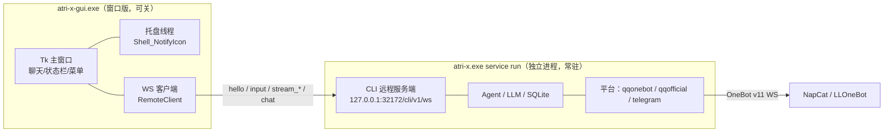

# Windows 桌面端与原生包（免安装 Python / Docker）

把 ATRI-X 打包成**本机可执行目录**，双击就是一个 Windows 桌面程序：聊天窗口 + 托盘常驻，
关掉窗口后台继续跑，接上 QQ OneBot 协议端后就是完整的群/私聊机器人。运行期仍然是纯标准库，
不需要装 Python、不需要装 Docker。

> 本页是"原生 exe / 桌面端"形态。想用 Docker Desktop 做容器化运维（备份/升级/回滚/健康接口），
> 用 [`deploy/windows/README.md`](../deploy/windows/README.md)；想部署到服务器，用
> [`deploy/README.md`](../deploy/README.md)。四种形态**共用同一份配置格式**，
> 换形态只需要搬 `app.toml` / `services.toml` / `state.toml` / `SOUL.md` / `.env`。

---

## 1. 形态与适用场景

| 形态 | 入口 | 适合 |
|---|---|---|
| **桌面端**（窗口版） | `atri-x-gui.exe` | 日常使用：聊天窗口、托盘常驻、开机自启、关窗口不退出 |
| 控制台 TUI | `atri-x.exe run` | 想要纯命令行、在 Windows Terminal 里看流式输出 |
| 后台服务 | `atri-x.exe service run` | 无人值守跑机器人（桌面端会自动帮你拉起） |
| 原生 exe（本页） | 拷目录即用 | 一台 Windows 机器上跑个人助理 / QQ 机器人 |
| **便携版 zip** | 解压后双击 `start-portable.bat` | 快速试跑、拷给别人复现问题、绿色部署；数据留在解压目录里（见 §7.2） |
| **安装版** | `ATRI-X-<版本>-setup.exe` | 普通用户长期使用：开始菜单/桌面快捷方式、开机自启、卸载项（见 §7.1） |
| Docker Desktop | [`deploy/windows/`](../deploy/windows/README.md) | 需要备份/升级/回滚/`/tasks` `/metrics` 运维接口 |
| Linux 容器 | [`deploy/README.md`](../deploy/README.md) | 多机、水平扩容、容器编排 |

> 不适合：需要多机/容器编排；需要 Docker 那套运维接口；需要无人值守的自动升级流水线。
> 构建细节、冻结后的技术限制见 [`packaging/README.md`](../packaging/README.md)。

### 1.1 桌面端的架构（关窗口为什么不掉线）



GUI **不是** Agent：它只是 `docs/frontend-api.md` 那套 WS 协议的一个前端。真正干活的是
`service run` 那个独立进程。所以：

- **关窗口 = 隐藏到托盘**，服务进程不受影响，QQ 机器人继续在线；
- 服务进程崩了不会拖垮窗口（界面显示「已断开」并自动重连）；窗口崩了也不影响机器人；
- 同一台机器上第三方前端（另一台设备、脚本、Web UI）也能连同一个服务端。

---

## 2. 构建

在**仓库根目录**执行（需要 Python 3.11+ 且带 `tkinter`，一次性装 PyInstaller）：

```bash
python -m pip install pyinstaller
python packaging/build.py
```

脚本会构建并**自己核验产物**（跑 exe 本体，而不是只看构建退出码）：

```
== ATRI-X windows packaging ==
python      : <Python 安装目录>\python.exe (3.14.7)
pyinstaller : 6.22.3
mode        : onedir
gui exe     : yes
dsh kernel  : no
artifact    : <仓库>\dist\windows\atri-x\atri-x.exe
size        : 40.1 MB in 50 file(s)
verify      : passed
```

可选依赖（Pillow 提供图像编解码加速；默认三个可选包全部排除，纯标准库也可用）：
`--with-pillow` 只保留 Pillow、`--with-extras` 只保留 numpy/PyYAML、
`--with-all-optional` 三个都留（旧的 `--with-pillow` 语义），`--check-env` 只探测构建环境后退出。
**构建环境没装 Pillow 时 `--with-pillow` 会以非零码失败**（避免"以为打了 Pillow 其实没有"），
显式加 `--allow-missing-pillow` 才降级为警告。产物侧可以核验真实后端：

```bash
"dist\windows\atri-x\atri-x.exe" -m atri_x.media.imagecodec.backend_probe --json
# 期望 {"backend": "pillow", ...}；构建机没装 Pillow 时是 "stdlib"
```

窗口版的启动诊断与 `/diagnostics` 也会显示同一份 `image_backend`（后端名 + 版本号）。

想要**内置 DSH 内核**（目标机不用另装 Node/dsh）就先组装一次再打包：

```bash
python packaging/assemble_kernel.py --modules "C:\path\to\node_modules"   # 已装 DSH 的机器
python packaging/build.py --with-kernel                                    # 333.4 MB / 24516 个文件
```

产物：

```
dist\windows\atri-x\
├── atri-x-gui.exe      ← 双击这个：桌面端（窗口 + 托盘）
├── atri-x.exe          ← 控制台版：service run / doctor / config check / -m <模块>
└── _internal\          ← 运行时、tkinter、内置配置资产、可选的内置 DSH 内核
```

把整个 `atri-x` 目录拷到目标机器即可用（**不要只拷 exe**）。单文件模式
`python packaging/build.py --onefile` 只有控制台版（15 MB 左右，首启慢、杀软误报更多，
且启动时要解压到 `%TEMP%`，**TEMP 不可写时直接起不来**）。

想要**两种交付形态**（便携版 zip + 安装包）一起出，用一条命令即可，两个产物都会各自自检：

```bash
python packaging/build.py --with-kernel --release
# → dist/portable/ATRI-X-<版本>-portable-win64.zip（解压即用，见 §7.2）
# → dist/installer/ATRI-X-<版本>-setup.exe（用户级安装，见 §7.1）
```

### 2.1 品牌图标与安装向导界面

图标和安装界面素材是**构建期生成、随仓库提交**的，日常构建不用管：

| 显示位置 | 用的素材 | 说明 |
|---|---|---|
| 桌面 / 开始菜单快捷方式、exe、卸载器、应用列表 | `atri_x/gui/brand/app.ico` | 快捷方式只存「图标位置 + 索引」，套的就是 exe 那份，不单独出图 |
| 窗口标题栏 / 任务栏按钮 | 同上（Tk `iconbitmap`） | Windows 上 Tk 默认用自带羽毛图标，**必须显式设置**才会跟 exe 走 |
| 右下角托盘 | 同上（16 逻辑像素，随 DPI 变 16→64） | `LoadImageW` 按 `SM_CXSMICON` 取，Windows 从多尺寸里挑档位 |
| 安装包 `setup.exe` 自身 | 同上（`SetupIconFile`） | |
| 安装向导左侧宣传图 | `packaging/assets/wizard-image*.png` | 比例 164:314；**只在「欢迎」「完成」两页**显示 |
| 安装向导右上角小图 | `packaging/assets/wizard-small*.png` | 58×58 / 116×116 |

换品牌图时：改 `packaging/make_assets.py` 顶部的默认源图（或传 `--icon-source` /
`--banner-source`），跑一次 `python packaging/make_assets.py`，再重跑构建即可。

---

## 3. 第一次启动（桌面端）

```bash
dist\windows\atri-x\atri-x-gui.exe
```

首次启动会发生三件事：

1. 在 `%APPDATA%\ATRI-X` 生成默认配置（**已存在就不覆盖**）：

   | 文件 | 作用 |
   |---|---|
   | `app.toml` | 行为、平台、工具、安全、维护等主配置 |
   | `services.toml` | `[providers.*]`、模型元数据、生图、视觉、语音、搜索通道 `[web_search]`、抓取通道 `[web_extract]` |
   | `state.toml` | 默认模式与模型（程序回写） |
   | `SOUL.md` | Agent 的 System Prompt |
   | `.env.example` | 环境变量模板，复制成 `.env` 后填密钥 |
   | `atrinis.toml` / `memories.toml` / `tool_tags.toml` | 外部事件入口、常驻记忆、工具标签 |
   | `plugins/` / `skills/` / `long_memory/` | Hook 插件、Skill、长期记忆目录（初始为空壳） |

2. 把 `app.toml` 的 `[platform.cli.server].enabled` 置为 `true`（**只改这一行**，写前留
   `app.toml.bak`，写完用 `tomllib` 重新解析校验）；在配置目录 `.env` 里写入本机登录
   token `ATRIX_CLI_LOCAL_TOKEN=<随机值>`（已有 token 或环境变量则复用，幂等）。
3. 后台拉起 `atri-x.exe service run`（日志在 `%APPDATA%\ATRI-X\gui\service.out.log`），
   然后用 WS 连上去。探测到 `127.0.0.1:32172` 已经有服务在跑时**不会重复启动**，直接复用。

三步把它变成"能说话"（**在桌面端「模型」页点几下就行**，也可以照下面手改文件）：

1. 「模型」页选中/新增一个 provider，填 Base URL 和密钥环境变量名（如
   `DEEPSEEK_API_KEY`），把 API Key 填进密钥框点「保存 Provider」（会写进
   `%APPDATA%\ATRI-X\.env`）；
2. 在同一个页面的「模型分配」里给工作/聊天模式选 provider + 模型（写 `state.toml`，
   几秒内热加载）；也可以复制 `.env.example` 为 `%APPDATA%\ATRI-X\.env` 后手填密钥；
3. 想让它能联网搜索：**默认就能用**（Firecrawl / Keenable 两条免注册通道，不用填 key）。
   要换通道或填 key，去同一个选项卡的「搜索服务」子页（详见 §4.2）；想接 DeepSeek 官方
   搜索/抓取就在那一页加 `deepseek` 通道（需要官方 API Key，按次计费），抓取通道在
   「抓取服务」子页配置；
4. 点页面右下角「重启后台服务」（provider、密钥、搜索与抓取通道都是启动期配置），或
   在聊天框里用 `/model` 临时切换。

手改文件的等价写法是：`services.toml` 里给 provider 配 `api_key_env`、密钥放进系统
环境变量或 `.env`、`state.toml` 里选默认模式与模型。

验收：

```bash
dist\windows\atri-x\atri-x.exe doctor --no-model
```

期望 `[config] check passed`、`[config] storage_writable passed`、
`[platform] configured passed`；`model_credentials` 在没填密钥时失败属正常。

---

## 4. 桌面端怎么用

| 位置 | 行为 |
|---|---|
| 选项卡 | 「对话 / 模型 / 人设卡 / 平台 / 在线 / 群友 / 知识库 / 进阶 / 日志 / 功能 / 工具权限」11 页，配置都能在界面里改（见 §4.2），`Ctrl+1`…`Ctrl+9`（第 10、11 页用「视图」菜单）或「视图」菜单切换 |
| 左侧会话栏 | 历史会话列表（当前会话带 `●`）；双击/回车切换会话，`刷新`/`新建` 按钮，`F5` 刷新 |
| 聊天区 | 用户消息、助手回复、推理过程（灰色）、通知（橙色）、错误（红色）分区显示；流式输出实时刷新 |
| 输入框 | `Enter` 发送、`Shift+Enter` 换行、`Tab` 触发补全（`/model`、`/help` 等） |
| 状态栏 | 左边是连接状态（已连接/连接中/已断开/鉴权失败），右边是运行状态（阶段 · 耗时 · 模型 · tokens） |
| 菜单 → 文件 | 新建会话、刷新会话列表、复制全部记录、清空聊天区、退出（后台继续）/ 退出并停止服务 |
| 菜单 → 视图 | 切到 11 个选项卡（等价于点选项卡标题） |
| 菜单 → 服务 | 重新连接、启动/确认后台服务、**重启后台服务**（改完配置用它生效）、停止后台服务（强制）、打开配置目录、打开后台日志 |
| 菜单 → 帮助 | 关于、托盘/后台说明 |
| 点窗口 ✕ | **隐藏到托盘**，服务继续跑；没有托盘时退化为"关闭窗口（服务仍在）"（首次会弹一次提示，见 §11） |
| 托盘图标 | 左键/双击 = 显示窗口；右键菜单：显示 / 新建会话 / 重新连接 / 打开日志 / 退出 / 退出并停止服务 |

### 4.1 会话列表与历史

左侧边栏列出本客户端能看到的会话，双击（或选中后回车）**切换过去**：

1. 界面发一条 `/resume <session_id>` 命令 —— 复用服务端既有的 `/resume`：权限、
   审计、命名、上下文切换全部由 ATRI-X 自己处理，GUI 不另写一套；
2. 同时请求该会话的 `history`（只读帧，见 `docs/frontend-api.md` 的「扩展帧」），
   把用户/助手消息灌进聊天区（工具与系统的中间消息不回放）；
3. `新建`（或 `Ctrl+N`）发 `/new` 建新会话并刷新列表。

连上后台服务时会自动拉一次会话列表；断线时列表清空。历史记录来自服务端数据库，
不是 GUI 本地缓存 —— 所以换一台前端连同一个服务端也能看到同样的会话。

### 4.2 配置选项卡（模型 / 人设卡 / 平台 / 在线 / 群友 / 知识库 / 进阶 / 日志 / 功能 / 工具权限）

窗口上方是 11 个选项卡，**配置都能在界面里改，不用再手搓 TOML**：

| 选项卡 | 能改什么 | 写入 | 生效时机 |
|---|---|---|---|
| 对话 | 只聊天，不写配置 | — | — |
| 模型 | 三个子页：**LLM Provider / 模型分配**——Provider（Base URL / 密钥环境变量 / API Key / 模型列表 / API 协议 / **推理思考强度**（`reasoning_effort`：不设置 / none / minimal / low / medium / high）/ 请求头：每行一条 `Name: value`，网关强制要求时填，例如 OpenCode Go 的 `x-opencode-session`）+ 工作/聊天/命名/压缩四个模型槽位 + 默认模式，另可「获取可用模型」拉上游 `/models`、给模型起本地备注名；**搜索服务**——`web_search` 的通道列表（顺序即降级顺序，可上移/下移/新增自定义/删除）与单条通道表单（协议 DeepSeek 官方搜索 / Tavily / Firecrawl / Keenable / Exa / SearXNG / Antigravity CLI / Grok Build、密钥环境变量名与值、服务地址、CLI 可执行文件），免注册通道不填 key 也能用；**抓取服务**——`web_extract` 的通道列表与表单（协议 DeepSeek 官方抓取 / Jina Reader / 直接抓取，默认 Jina → 直接抓取） | `services.toml`（`[providers.*]`、`[web_search]`、`[web_extract]`）、`.env`、`state.toml`、`gui/model_catalog.json` | `state.toml` 几秒内热加载；Provider、密钥、思考强度、搜索与抓取通道需重启后台服务 |
| 人设卡 | 角色库增删改（名称/别名/标签/简介/可见性，`profile.md`、`world.md`、`greeting.md`、`examples.md`、`image_prompt.md`、`notes/*`）、生图预设、系统人设 `SOUL.md` | `characters/`、`SOUL.md` | 角色库 3 秒内自动重扫；`SOUL.md` 下一轮对话生效 |
| 平台 | QQ（OneBot v11）/ QQ 官方机器人 / Telegram 的启用、地址、token 变量与值、唤醒词；本地 CLI 服务端；各平台超级管理员 | `app.toml`、`.env` | 重启后台服务 |
| 在线 | 三段状态（后台服务 / OneBot 协议端 / QQ 平台）+ **连接/断开开关**：只改 `[platform.qqonebot].enabled` 并重启后台服务，不用手改 TOML（见 §4.8）；还可就地改**唤醒词**（写回 `[platform.qqonebot].trigger_keywords`，逗号分隔；群里 @机器人 或消息以唤醒词开头都会叫醒） | `app.toml` 的 `[platform.qqonebot].enabled` / `trigger_keywords` | 点按钮即重启生效；唤醒词需重启后台服务 |
| 群友 | 按群管理群友档案：备注名、标签、角色数据（自由文本）、头像（下载/本地图片），群友列表来自聊天历史库 | `gui/members.json`、`gui/avatars/*.png` | 只影响界面（后台服务暂不读） |
| 知识库 | 群知识库 / FAQ 的全局开关与上限（每群条数、问题/答案/别名/关键词/匹配扫描字符数），并只读列出 `state.toml` 里各群的条目；条目增删用群里的 `/faq` 命令 | `app.toml` 的 `[group_knowledge]` | 重启后台服务 |
| 进阶 | 生图 / 图片转提示词 / 视觉回退 / 语音转写；**本地生图服务挂载**（端口映射 / SSL 链接）；长期记忆、自学习、群分析、群服务、Atrinis 开关；日志级别与保留天数；生图 API 的「获取可用模型」与模型备注名；三个二级设置窗口（自学习 / HOOK 插件 / 定时维护任务，其中维护任务支持每天 / 每周 / 每月 / 自定义 cron / 指定日期一次性）；整页可竖向滚动 | `services.toml`、`app.toml`、`atrinis.toml`、`plugins/hooks.toml`（+ `.env`、`gui/model_catalog.json`） | 重启后台服务；Hook 配置可用 `/hooks reload` |
| 日志 | 运行日志 / 审计日志 / Atrinis 日志 / 后台服务输出 / 界面操作五个通道；按日期、级别、关键字筛选，可自动刷新、打开文件/目录、复制、**导出当前视图** | 只读 | — |
| 功能 | 只读清单：逐项显示"已启用 / 已停用 / 未配置"与关键配置；双击跳到对应选项卡；右侧是连接状态与日志入口 | — | — |
| 工具权限 | 按群设置工具授权：左栏是群列表 + 作用域输入（**候选来自会话库里的真实群**；保存时自动把 `·` / 全角冒号 / 空白归一成半角 `:`，并把文件里旧写法的小节迁移到规范键），右侧是 **chat 模式 / work 模式两个子选项卡**，每个下面是可纵向滚动的工具菜单——每个工具一行（激活状态徽标 + 中文名 + 工具名 + 风险等级 + 一句话功能解释 + 激活 / 停用按钮），各自有搜索、「只看已激活」与「常用」「只读」预设、三态（继承通用 / 仅白名单 / 禁止全部）；三个子选项卡中的第三个是 **「工具参数（全局）」**——每个工具一组可展开 / 收起的参数面板（生图留档 `metadata_store`、搜索通道顺序、记忆写入上限、风险阈值等），有参数的工具行右侧多一个「参数」按钮可直接跳过去；顶部一行显示群内 `/tools allow` 写入的通用白名单作为兜底；下方是"群聊里显示工具调用进度"开关 | `state.toml` 的 `[group_policy."<平台:scope>"]`（`tool_allowlist_chat` / `tool_allowlist_work`，以及通用的 `tool_allowlist`）、`app.toml` / `services.toml` 里的工具参数（`[tools]` / `[security]` / `[ops]` / `[image_generation*]` / `[web_search]` / `[resident_memory]` / `[angel_memory]` / `[self_learning]` / `[group_analysis]` / `[media]` / `[vision]` …）、`app.toml` 的 `[platform.qqonebot].show_tool_preview_in_group` | 工具授权 15 秒内热加载；工具参数与进度开关需重启后台服务 |

约定：

- **工具权限页的菜单**：工具清单（中文名 / 一句话功能解释 / 分组 / 风险等级）在
  `atri_x/gui/toolcatalog.py`，菜单控件在 `atri_x/gui/toolmenu.py`；点「激活」按钮或点
  整行都能切换，徽标显示「已激活 / 未激活」；「继承全局」「禁止全部」模式下按钮统一置灰
  （全群策略由模式决定，不逐个选）。白名单保存时自动补 `discover_tool`，否则模型发现
  不了工具；没有激活任何工具时，保存后本群只剩 `discover_tool`。
- **工具参数（全局）**：同一页第三个子选项卡，按工具分组渲染可展开 / 收起的面板，每个字段
  下面标着"写入哪个文件的哪个小节"。面板只提交**改动过**的键，所以保存一个参数不会重写
  同小节其它键的行内注释；三态字段（默认 / 开 / 关）选「默认」= 删掉该键、回到配置层默认
  值。定义与读写规则在 `atri_x/gui/toolsettings*.py`，控件在 `atri_x/gui/toolparams.py`。
  这些参数是整机生效（与群无关），保存后需要重启后台服务。
  1.0.3 起「全局」面板新增**内容安全**一组开关（启用 / 模式 / 审计路径 / 拦截回复 / 扫描上限 /
  剥离工具图片 / 禁出站图片 / 禁出站文件），「媒体与视觉」面板新增**图片精度 `detail`、
  识图触发时机 `trigger`、前置描述短超时、图片外发隐私开关、SauceNAO 以图搜图**等字段；
  词表类别、敏感信息类别与逐类动作仍在 `app.toml` 的 `[safety]` 段手工配置。
- **密钥只写 `.env`**：界面只显示"已设置 / 未设置 + 掩码"，不回显明文；读取时
  进程环境变量优先于 `.env`（与 `docs/configuration.md` 的规则一致）。输入框默认
  掩码，右侧「显示 / 隐藏」按钮可以临时看明文；保存成功后会自动清空并恢复掩码。
- **保存前留备份**：文件第一次被界面写之前留 `<文件名>.gui.bak`（之后每次保存覆盖
  上一份，相当于"撤销上一次保存"），可手工回滚。
- **保存前校验**：写盘前用 `tomllib` 重新解析整份文件，解析不过就**不落盘**，避免
  把配置写坏导致服务起不来。
- **保存后回读校验**：模型页的 Provider 与模型分配保存后，会用**同一个读配置的函数**
  从磁盘读回来逐字段比对；界面值没有真正写进 `services.toml` / `state.toml` 时直接报错
  （「写入后回读与界面不一致」），不再出现"界面上改了、文件里没变、重启后又变回去"。
  模型分配还有几条硬规则：provider 与模型必须同时填写；工作 / 聊天两个槽位不能清空
  （清空会让后台服务启动失败）；命名 / 压缩槽位清空 = 从 `state.toml` 删掉该小节。
- 保存后状态行会说明该改动是"热加载"还是"需要重启"；每个配置页右下角有「重启后台
  服务」，也可以走「服务 → 重启后台服务」。
- 界面只改它负责的那几个键，**不覆盖**其它键与注释；更细的参数（并发、重试、提示词
  策略等）以配置文件为准，常用工具参数已收进「工具权限 → 工具参数（全局）」。手改文件后
  点该页的「重新载入」即可同步。
- **GUI 私有文件不进配置文件**：模型目录/备注名、群友档案、头像、界面操作日志都放在
  `<配置目录>\gui\` 下（如 `%APPDATA%\ATRI-X\gui\`）。它们不是 ATRI-X 的配置项，
  搬配置时按需一起拷。

### 4.3 模型目录与备注名（模型 / 进阶页）

不想手打模型名时：

1. 在「模型」页选一个 Provider，点 **获取可用模型** —— 界面对
   `{base_url}/models` 发一次 `GET`（`/v1` 拼法不对手会自动补试另一种），密钥用
   该 Provider 的 `api_key_env`（进程环境 → `.env`），结果落进
   `gui/model_catalog.json`；
2. 在「可用模型」下拉里点选，按 **加入列表** 追加到该 Provider 的 `models`；
3. 想给模型起中文别名：在「模型备注名」里选模型、填备注、按 **保存备注**。之后所有
   模型下拉都会显示成 `备注（真模型名）`，保存时自动还原真模型名写进配置，**不会**
   把备注名写进 `services.toml`。

「模型分配」四个槽位的下拉都是可滚动列表（点箭头展开、滚轮/方向键选择），模型名也
允许直接手打；换过配置文件之后点 **刷新模型列表** 重读 `services.toml` 与模型目录，
不必重启界面。

**推理思考强度（`reasoning_effort`）**：Provider 表单里的「推理思考强度」下拉是
1.0.2 新增的。选中 `none` / `minimal` / `low` / `medium` / `high` 保存后写进
`[providers.<name>].reasoning_effort`，之后该 Provider 的每个请求都会把同名值放进
请求 JSON；选「（不设置）」= 从文件删掉该键、请求里不发送。它只对支持这个参数的
模型/网关有效（OpenAI o 系、部分中转站）；同一个 Provider 里想按模型区分，可在
`services.toml` 的 `[providers.<name>.model_configs."<model>"].reasoning_effort`
里单独覆盖（空串回落到 Provider 级）。写错档位会在启动期和保存时都被同一个白名单
拒绝，不会静默发到上游换一个 400。改完需重启后台服务。

「进阶」页的生图区同理：填好生图 Base URL 与密钥后点「获取可用模型」即可切换生图
模型，备注名存在同一份 `gui/model_catalog.json` 里（键是 `image_generation`）。

自己部署生图（ComfyUI / 本地 OpenAI 兼容服务）时不用手拼地址：「进阶 → 生图 →
本地生图服务挂载」提供了两种挂载方式：

| 挂载方式 | 填什么 | 生成的 Base URL |
|---|---|---|
| 端口映射 | 主机（默认 `127.0.0.1`）+ 端口（默认 `8188`） | `http://127.0.0.1:8188/v1` |
| SSL 链接 | AUTODL「自定义服务」给的 HTTPS 地址 | `https://xxxx-8188.gpuhub.com/v1` |

填完点 **填入 Base URL** 或 **检测服务**。检测是只读的 `GET`：能拉回 `/models` 就
判定为 OpenAI 兼容并自动记入模型目录；只认 ComfyUI 原生接口（`/system_stats`、
`/queue`）时会明确提示——ATRI-X 调用的是 OpenAI 兼容的
`POST {base_url}/images/generations`，ComfyUI 原生接口需要先加一层 OpenAI 兼容转接。
两种挂载生成的仍然是普通的 `base_url`，`services.toml` 的字段没有新增。

### 4.4 日志页

排障时不用去翻文件夹，「日志」页把五类日志放在一个窗口里：

| 通道 | 文件 | 看什么 |
|---|---|---|
| 运行日志（atri-x） | `<数据目录>\logs\atri-x-YYYY-MM-DD.log` | 主流程、模型调用、工具执行 |
| 审计日志（audit） | `<数据目录>\logs\audit-YYYY-MM-DD.log` | 权限、敏感操作 |
| Atrinis 日志（atrinis） | `<数据目录>\logs\atrinis-YYYY-MM-DD.log` | 外部事件入口 |
| 后台服务输出 | `<配置目录>\gui\service.out.log` | 服务进程 stdout/stderr（启动失败、崩溃栈常在这里） |
| 界面操作 | `<配置目录>\gui\gui.log` | 点了保存/拉了模型/下载头像等 GUI 动作（追加写，512 KiB 轮转） |

结构化通道可以按日期、级别（debug/info/warn/error）、关键字过滤，并选择显示条数
（100…3000）；纯文本通道只按关键字过滤（每行没有统一 `level=`）。勾「自动刷新」每
3 秒重读一次。默认从新到旧显示，`ERROR`/`WARN`/`DEBUG` 分别用红/橙/灰着色。

**导出**：点「导出…」把**当前视图**（通道 + 日期 + 级别 + 关键字过滤之后的行）存成
`.log`，文件头会写上通道、日期、级别、关键字、行数与导出时间——贴给别人排障时不用
再补上下文。导出用 UTF-8 + LF，不经过后台服务。

### 4.5 群友角色数据（群友页）

「群友」页按群管理"每个人"的资料，方便查看/修改：

1. 顶部下拉选群/会话作用域 —— 列表来自后台服务的聊天历史库（`chat_messages` 表，
   **只读**打开，不建表不迁移）：谁发过言、发了多少条、最后一次什么时候；
2. 左表带**头像缩略图**，右侧编辑器可以改昵称、**备注名**（列表优先显示）、标签、
  角色数据（自由文本，最长 4000 字）；
3. 头像：QQ 平台可以「下载头像」（`q1.qlogo.cn`，JPEG 会经内置图像编解码转成 PNG，
   不依赖 Pillow）；也可以「选择本地图片」；缓存写在 `<配置目录>\gui\avatars\`；
4. 点「保存档案」写入 `<配置目录>\gui\members.json`；「删除档案」只删这份档案与头像
   缓存，聊天历史不受影响。

> 群友档案目前**只给界面看**：后台服务与 Agent 还不读它（不影响对话行为）。后续要
> 把它接进提示词时，从 `gui/members.json` 读即可。

### 4.6 知识库页

「知识库」页管的是群聊里的**本地确定性 FAQ**（命中后由服务端直接回答，不建 Session、
不调 LLM、不进提示词）：

1. 上半部分可改 `app.toml` 的 `[group_knowledge]`：总开关、每群条数上限、问题/答案
   最大字符数、每条别名/关键词上限、匹配扫描字符数。留空表示用内置默认值。保存后需
   重启后台服务；
2. 下半部分**只读**列出 `state.toml` 里现有的条目（按 `平台:群` 分组），可以按关键字
   筛选、点一行看别名/关键词/id/更新时间；
3. 条目本身由群里的 `/faq` 命令维护（`/faq add` / `/faq list` / `/faq remove` /
   `/faq clear`），界面不直接写 `state.toml` —— 那份文件由后台服务运行期回写并热加载，
   两边同时写会互相覆盖。

### 4.7 进阶页的二级设置窗口

「进阶」页上有三个按钮，点开独立窗口（不占主选项卡）：

| 按钮 | 窗口 | 写哪里 | 生效 |
|---|---|---|---|
| 自学习设置… | 保留天数、候选出现次数/用户数门槛、含义与观察的字符/条数上限、挖掘超时 | `app.toml` 的 `[self_learning]` | 重启后台服务 |
| HOOK 插件配置… | 直接编辑 `plugins/hooks.toml`（等宽字体、保存前校验 TOML 语法），带规则/插件计数 | `plugins/hooks.toml` | 群里执行 `/hooks reload` 或重启后台服务 |
| 定时维护任务… | 8 个维护任务逐个开关；周期任务选 **每天 / 每周 / 每月** 再填时分（每周还选周几、每月还选几号），界面实时显示生成的 cron 与「下次触发」时间，cron 表达不了的写法用 **自定义 cron**；也可以切 **指定日期**（一次性，填 `YYYY-MM-DD` + `HH:MM`）。清理类任务还能改保留天数 | `app.toml` 的 `[maintenance.*]`（一次性任务写 `run_at`） | 重启后台服务 |

「进阶」页内容比窗口高（左边「生图 + 运行与日志」、右边三块开关），整页可以竖向
滚动：窗口拉小时滚轮/滚动条就能看到下面的开关与「定时维护任务…」入口，不会被挤到
窗口外面；窗口拉大时滚动条自动收起。

一次性维护任务的行为：到点只跑一次，跑完不再重复；引擎仍要求 `schedule` 是合法 cron
表达式，所以窗口里会保留周期表达式做兜底（见
[配置说明](configuration.md#日志与维护任务)）。

**「退出」与「停止服务」是两件事**：

- 退出（托盘/文件菜单）只关窗口，`service run` 继续跑，QQ 机器人不掉线；
- 「停止后台服务（强制）」会中断当前任务、机器人掉线。Windows 上没有"给另一个控制台
  进程发 Ctrl+C"的可靠办法，所以这里是 `taskkill`；需要优雅停机时请在控制台里
  `Ctrl+C`（用 `atri-x.exe service run` 手动起的场景）。

窗口位置会记在 `%APPDATA%\ATRI-X\gui\window.json`；窗口版是单实例，重复双击会**把已有
窗口提到前台**。

> 想要纯命令行：`atri-x.exe run`（本地 TUI，需要真终端；双击会开 cmd 窗口，建议用
> Windows Terminal 打开该目录再跑）。

### 4.8 在线页：状态监测与连接开关

「在线」页把「到底哪一环断了」并排显示出来，并提供一个上下线开关：

| 卡片 | 看什么 | 数据来源 |
|---|---|---|
| 后台服务 | 运行中（PID）/ 未运行、版本、运行时长、收发消息计数、最近一条消息时间 | 进程 pid 记录 + 后台 `/healthz` |
| QQ 平台 | 配置是否启用、连接状态（已连接 / 未连接 / 等待登记）、连接次数、最近上线/断开、最近错误、当前**唤醒词**（可就地修改） | 后台 `/healthz` 的 `platforms[]`（后端在真正连上/断开时写入）+ `app.toml` |
| 协议端（NapCat） | `ws_url`、端口是否已监听；按钮「检测端口」「启动协议端」「打开 WebUI」 | 一次 TCP 连接探测 |
| 模型与就绪 | 各 provider 的健康/熔断、`/ready` 的进程与调度心跳检查 | 后台 `/healthz` |

- **连接（上线）**：检查 `[platform.qqonebot]` 的 `ws_url` 与 `.env` 里的令牌是否都填了 →
  写 `enabled = true` → 重启后台服务 → 状态自动轮询到「已连接」。协议端没监听时会先提示
  （仍可选择继续，后台会自动重连）。
- **断开（下线）**：写 `enabled = false` → 重启后台服务，QQ 机器人下线但进程继续跑。
- **唤醒词**：QQ 平台卡片上的输入框 +「保存唤醒词」写 `[platform.qqonebot].trigger_keywords`
  （中英文逗号分隔）。群里 **@机器人**、或消息**以唤醒词开头**（如「atri 你好」）都会叫醒
  模型；留空需确认，效果是只认 @ 与回复。保存后需重启后台服务生效。
- 只有点「连接/断开」与「保存唤醒词」才会写 `app.toml`；这一页**不碰** `.env` 里的密钥。
- 「复制连接信息」把后台 WS、协议端地址、令牌状态、WebUI 地址复制到剪贴板，换机器时对照用。
- 便携版 / 安装版**内置协议端**时（见 §5.1），「协议端」卡片会显示内置环境路径，并多出
  「启动协议端」（新开控制台窗口，关窗即下线）与带令牌的「打开 WebUI」。内置协议端的
  OneBot 令牌、端口、NapCat 的 `onebot11.json` / `webui.json` 都由桌面端首次启动时自动
  生成，不需要手改；它只在**发行包自带** `qqproto\` 时生效，自备 NapCat 的部署完全不受影响。

**状态接口是桌面端自动开的**：首次启动时桌面端检查 `.env`，缺 `ATRIX_HEALTH_ADDR`
就补 `127.0.0.1:32171`（端口被占则顺延），缺 `ATRIX_OPS_TOKEN` 就生成随机值；
已有值一律不动。后台服务读到后才会注册 `/healthz`（见 README「端口与健康接口」）；
手动改过这两个变量后要重启后台服务。

> 要一次把「连得上、发得出、收得到」验一遍，仍推荐先在命令行跑
> `atri-x.exe -m atri_x.platform.qq_onebot.smoke`（见 §5.3）；「在线」页管日常状态，
> 冒烟管首次排障。

---

## 5. 接 QQ（OneBot v11）

ATRI-X 是 OneBot v11 的**正向 WebSocket 客户端**：它主动连协议端的 WS 服务端。
所以 QQ 侧只需要一个协议端，ATRI-X 这边**不改代码**。

### 5.1 起协议端（以 NapCat 为例）

> **便携版 / 安装版已经内置一套协议端**（NapCat + 便携 QQ，随包约 1.2 GB，见 §7.2）：
> 不需要做下面 1–4 步，直接在「在线」页点「启动协议端」→「打开 WebUI」用手机 QQ 扫码
> （建议小号）→ 回「在线」页点「连接（上线）」即可。内置环境的 OneBot 端口、WebUI 端口、
> 令牌、NapCat 的 `onebot11.json` / `webui.json` 由桌面端首次启动时自动生成并写进
> `%APPDATA%\ATRI-X\.env`，**包里不含任何令牌**。本节剩余内容适用于**自备** NapCat /
> LLOneBot 的部署，或想自己装一份更新的协议端。

NapCat 基于 NTQQ 客户端，Windows 上原生支持，自带 WebUI：

1. 安装并启动 NapCat，按提示用手机 QQ **扫码登录**（这一步的登录态要一直保持）；
2. 打开 WebUI（默认 `http://127.0.0.1:6099/webui`，token 在启动日志或
   `webui.json` 里）；
3. 在"网络配置"里新建 **WebSocket 服务端**（正向 WS），示例端口 `3001`，
   建议设一个 `token`，并勾选"保存时启用"；
4. 确认端口可访问（浏览器直接访问 `http://127.0.0.1:3001` 会有响应）。

> 其他 OneBot v11 实现同理（LLOneBot 等），只要是**正向 WS 服务端**即可。
> 注意：这些都基于 NTQQ 的非官方 hook，存在**账号风控/封禁风险**；建议用小号，
> 不要拿主号做实验。合规路线是项目内置的 `[platform.qqofficial]`（QQ 官方机器人）。

### 5.2 打开 ATRI-X 的 OneBot 平台

桌面端「平台」页可以直接填（勾选启用、填 WS 地址与 `access_token`、点「保存平台配置」
→「重启后台服务」）；等价的手改方式是编辑 `%APPDATA%\ATRI-X\app.toml`，把默认注释掉的
这段打开：

```toml
[platform.qqonebot]
enabled = true
# 协议端的实际端口：NapCat 上面配的 3001；ATRI-X 默认值是 6700，两者对齐即可
ws_url = "ws://127.0.0.1:3001/"
# 协议端设了 token 才需要下面这行；值填进系统环境变量或 .env
access_token_env = "QQONEBOT_ACCESS_TOKEN"
# 群里被 @、被回复之外，消息里带这些词也会唤醒
trigger_keywords = ["atri"]
send_file_mode = "base64"        # 跨机器安全；同一文件系统可用 file_uri
inbound_dedup_enabled = true     # 断线重连不会把旧消息重放给模型
```

`.env`（或系统环境变量）里放：

```bash
QQONEBOT_ACCESS_TOKEN=协议端那个 token
```

**群里的触发规则**：默认只响应 `@机器人`、`回复机器人消息`、或含 `trigger_keywords`
的消息；群策略里可改成 `all`（全回）/ `keyword` / `reply` / `off`。私聊默认全回。

### 5.3 先冒烟，再上线

不要一上来就开桌面端然后盯着聊天窗等回复——先按协议层验一遍：

```bash
# 只验证连接 + get_login_info
dist\windows\atri-x\atri-x.exe -m atri_x.platform.qq_onebot.smoke --json

# 验证发送通道（往指定群发一条测试文本）
dist\windows\atri-x\atri-x.exe -m atri_x.platform.qq_onebot.smoke ^
    --url ws://127.0.0.1:3001/ --group 123456 --text "连通性测试" --json

# 验证事件推送方向（监听 20 秒，期间在群里 @ 一下机器人）
dist\windows\atri-x\atri-x.exe -m atri_x.platform.qq_onebot.smoke --listen 20
```

期望看到（样例，假协议端的输出形状与真实协议端一致）：

```
[qqbot] connecting: ws://127.0.0.1:3001/ (token=yes)
[qqbot] connected: self_id=10001 nickname=bot
[qqbot] sent group 123456 message_id=42
[qqbot] event: post_type=message type=group group=123456 user=20002 text=hello
{"ok":true,...,"event_count":1}
```

`--json` 的最后一行是结构化结果：`ok` / `self_id` / `nickname` / `sent` /
`event_count` / `events`。这一步通了，才说明"连得上、发得出、收得到"。

### 5.4 启动

改完 `app.toml` 后重启桌面端（或「服务 → 重新连接」）。更省事的办法是直接去
**「在线」页点「连接（上线）」**：它只改 `[platform.qqonebot].enabled` 并重启后台服务，
状态卡片会显示到「已连接」为止（见 §4.8）。然后群里 `@机器人 你好` 试一句。
回复不出来时按 §11 的顺序排查：先看「在线」页三张卡片哪一环是红的，再确认冒烟通过，
最后才看群策略与触发词。

---

## 6. 开机自启

两种方式，效果一样（都是当前用户级、不需要管理员）：

```bash
# 方式一：桌面端自带的开关（写 HKCU\...\Run，值为 atri-x-gui.exe --minimized）
atri-x-gui.exe --enable-autostart
atri-x-gui.exe --autostart-status
atri-x-gui.exe --disable-autostart

# 方式二：安装时顺便打开（安装包里「开机自启」任务是默认勾选的）
atri-x.exe -m atri_x.dist.install install --autostart
# 或直接用安装包：ATRI-X-<版本>-setup.exe（默认勾选「开机自动启动」）
```

自启动的命令带 `--minimized`：开机后窗口**不弹出来**，直接进托盘，后台服务照常拉起。
想取消就用同上的 `--disable-autostart`（或安装器的卸载流程会自动清理）。

> 自启指向的是**当前这个 exe 的绝对路径**。把整个目录搬到别处之后要重新开一次自启。

---

## 7. 安装 / 卸载

不想每次进目录双击，就装进用户目录（开始菜单 + 桌面快捷方式 + 「应用和功能」卸载项）：

```bash
# 安装到 %LOCALAPPDATA%\ATRI-X\app（把整个发行包复制过去）
dist\windows\atri-x\atri-x.exe -m atri_x.dist.install install --autostart

# 只看计划，不落盘
dist\windows\atri-x\atri-x.exe -m atri_x.dist.install install --dry-run

# 看装在哪、快捷方式是否存在
dist\windows\atri-x\atri-x.exe -m atri_x.dist.install status --json

# 卸载（默认保留 %APPDATA%\ATRI-X 的用户数据；连数据一起删要显式 --purge-data）
dist\windows\atri-x\atri-x.exe -m atri_x.dist.install uninstall --yes
dist\windows\atri-x\atri-x.exe -m atri_x.dist.install uninstall --yes --purge-data
```

| 选项 | 说明 |
|---|---|
| `--target DIR` | 自定义安装目录 |
| `--no-desktop` | 只建开始菜单快捷方式，不建桌面 |
| `--autostart` | 安装后顺手开自启 |
| `--add-path` | 把安装目录加进**用户** PATH（命令行里直接敲 `atri-x`） |
| `--force` | 目标目录非空也覆盖（升级用） |
| `--keep-app` / `--purge-data` | 卸载时保留程序目录 / 连用户数据一起删 |

安装器只写 `HKCU` 与用户目录，不动 `HKLM` / `Program Files`，不需要管理员权限。
源码运行（未冻结）时它**不复制代码**，只写一个开发版启动器，方便本地验证。

### 7.1 安装包（Inno Setup，推荐给普通用户）

普通用户不需要先解压 zip 再跑命令，直接发一个安装包：

```bash
# 构建（先有 dist/windows/atri-x；ISCC 查找顺序见 packaging/README.md §7）
python packaging/build_installer.py
python packaging/build_installer.py --verify          # 静默安装/卸载自检
python packaging/build.py --with-kernel --installer   # 构建 + 打包一条龙
# 产物：dist/installer/ATRI-X-<版本>-setup.exe
```

> 构建时加 `--with-qqproto <NapCat.Shell 目录>` 会把**脱敏后的内置 QQ 协议端**
> （NapCat + 便携 QQ）一起装进去，安装完即可在「在线」页「启动协议端」；构建方式与
> 便携版一致，见 [`packaging/README.md`](../packaging/README.md) §3.5。

安装包做的事：把整个 `dist/windows/atri-x` 装到 `%LOCALAPPDATA%\ATRI-X\app`，建开始菜单
快捷方式（桌面图标可选），默认勾选「开机自动启动」（写 HKCU `Run\ATRI-X`，
`atri-x-gui.exe --minimized`），并在 `{app}\install.json` 里写
`"installer":"inno"` 标记。

| 行为 | 说明 |
|---|---|
| 卸载 | 「设置 → 应用」里的 `ATRI-X`，或安装目录的 `unins000.exe`；卸载前会 `taskkill` 掉还在跑的 GUI/后台服务，内置协议端的运行期配置（`{app}\qqproto` 下）也一并删除 |
| 用户数据 | `%APPDATA%\ATRI-X` **默认保留**；交互式卸载会问一次「是否同时删除用户数据」 |
| 与脚本安装的关系 | 检测到 `installer=inno` 后，`atri-x -m atri_x.dist.install uninstall` 会**拒绝**执行并提示用 `unins000.exe`（避免留下指向已删目录的卸载器）；确实要强删加 `--force` |
| 静默安装 | `ATRI-X-<版本>-setup.exe /VERYSILENT /SUPPRESSMSGBOXES /NORESTART /DIR=<目录> /MERGETASKS=!autostart,!desktopicon` |
| 覆盖升级 | 直接再跑新安装包即可；**先退出正在运行的 ATRI-X**——安装器带 `AppMutex=ATRI-X-GUI`，检测到 GUI 在跑会提示「当前正在运行」并中止（自检脚本也会因此失败） |

实测 0.9.10（含内置内核与内置 QQ 协议端的 1,535.6 MB onedir → 436.2 MB 安装包）：静默安装
65.4 s / 27032 个文件，`atri-x.exe --version` 正常，静默卸载 8.3 s 且目录被清空。构建环境有两个坑（TEMP 必须在
本地盘、安装根路径要够短）写在 [`packaging/README.md`](../packaging/README.md) §7.1。

### 7.2 便携版 zip（解压即用）

不想安装、或者要把问题现场整包发给别人复现，用便携版 zip（构建细节见
[`packaging/README.md`](../packaging/README.md) §8）：

```bash
python packaging/build.py --with-kernel --with-portable --portable-verify   # 构建 + 便携包 + 解压自检
python packaging/build.py --with-kernel --release                          # 便携包 + 安装包（都自检）
python packaging/build.py --with-kernel --with-qqproto "D:\napcat\NapCat.52230.Shell" --release
# 产物：dist/portable/ATRI-X-<版本>-portable-win64.zip（+ 同名 .zip.sha256）
```

最后一条会在包里多一个 `qqproto\` 目录（内置 NapCat + 便携 QQ，约 1.2 GB，脱敏后不含任何
令牌/登录态），解压后即可在「在线」页「启动协议端」；不指定 `--with-qqproto` 时产物与
旧版相同（需要自备协议端）。

解压后目录里有四个可双击的入口：

| 文件 | 作用 |
|---|---|
| `start-portable.bat` | **推荐**。便携模式：`APPDATA` 指到 `<解压目录>\data\appdata`，配置/会话/日志都留在文件夹里 |
| `start-normal.bat` | 标准模式：数据在 `%APPDATA%\ATRI-X`，与安装版共用同一份配置与会话 |
| `debug-console.bat` | 调试控制台：打印 `--version` 与 `doctor --no-model`，并留一个命令行窗口；带参数时直接转发给 `atri-x.exe` |
| `atri-x-gui.exe` / `atri-x.exe` | 直接双击等价于标准模式；控制台版用于 `service run` / `config check` / `-m <模块>` |

两种模式的数据目录互不可见：便携模式适合把「程序 + 配置 + 会话库 + 日志」整体压缩发走；
标准模式适合与已安装的版本共用同一份数据。另外包里还有 `README.txt`（使用/排障）与
`build-info.json`（版本、Python/PyInstaller、内置内核版本、文件数）。

注意事项：

- **解压到短路径**（例如 `D:\ATRI-X`）。内置内核有 191 字符级相对路径，解压根目录太长会
  解压失败；构建脚本会打印本包的路径上限。
- 不写注册表、不建快捷方式，**删掉文件夹即卸载**（便携模式下连数据一起删）。
- 无代码签名，SmartScreen 可能提示一次；README 里有说明。
- 内置 DSH 内核（`_internal\runtime`）与安装版同一份，目标机不需要另装 Node。

**换机器（或整体备份）时要搬的东西** —— 新版发行包已内置协议端，所以是「程序 + 配置」两样：

1. `ATRI-X-<版本>\` 程序目录（**已含**内置 NapCat + 便携 QQ；便携模式的数据在
   `<目录>\data\`，一起拷走）；
2. 配置目录：标准模式是 `%APPDATA%\ATRI-X`（`app.toml`、`.env` 里的模型与 OneBot 令牌、
   人设、会话库）。

若你用的是**自备** NapCat，再额外拷它的目录。新机器上协议端要**重新扫码登录**一次
（登录态与设备/环境绑定）：启动桌面端 →「在线」页「启动协议端」→「打开 WebUI」扫码 →
「连接（上线）」；`ws_url` 与 OneBot 令牌都在配置目录里，不用重填。自备 NapCat 也一样，
只是「启动协议端」换成你自己启动它。

---

## 8. 内置 DSH 内核（可选）

ATRI-X 通过 ACP 调 DSH（`dsh --profile acp`）。默认会去找 PATH 上的 `dsh`；如果你不想在
目标机器上另装 Node + dsh，可以把内核**打进包里**：

```bash
# 在有 DSH 的机器上组装（只读源 node_modules，不跑 npm、不联网）
python packaging/assemble_kernel.py --modules "C:\path\to\node_modules"
# → runtime/dsh-kernel/{kernel.json, node/node.exe, node_modules/...}

# 打包时带上（默认检测到 kernel.json 就自动带）
python packaging/build.py --with-kernel
```

组装脚本会**真启动一次 ACP 服务端并握手**，返回 `deepseek-harness-acp/...` 才算成功。
实测：384 个包 / 189.1 MB + `node.exe` 88.5 MB（合计 277.6 MB）；自动补拷 2 轮 peer
依赖后通过。

运行期可以随时查看/复验：

```bash
atri-x.exe -m atri_x.sidecar list            # 发现了哪些内置运行时
atri-x.exe -m atri_x.sidecar status          # 内置 DSH 内核的版本/路径/是否核验过
atri-x.exe -m atri_x.sidecar dsh-command     # 打印实际会用的启动命令
atri-x.exe -m atri_x.sidecar verify --acp    # 真跑一次 initialize 握手
atri-x.exe -m atri_x.agent.dsh.smoke         # 完整 ACP 冒烟（需要模型密钥）
```

- 想换/临时指定内核目录：设 `ATRIX_DSH_KERNEL=<内核目录>`；
- 想给别的位置的运行时：设 `ATRIX_RUNTIME_DIR=<运行时根目录>`（下面可有多个运行时）；
- 找不到内核时自动回退到 PATH 上的 `dsh --profile acp`，不会报错；
- 内核每轮路由都会新建一个一次性会话（结束时只 `session/close`，不删历史），所以
  `DSH_HOME/sessions` 会随使用增长：`[maintenance.dsh_cleanup]`（默认开启，保留 30 天）
  只清过期会话历史与会话缓存，`profiles/` 一律保留。桌面端的每日会话总结
  （`[maintenance.daily_summary]`）汇总的是 ATRI-X 自己的 SQLite 会话，不含内核内部历史。

> 说明：内置内核解决的是"**运行时依赖**"；把 DSH 接进对话路由（成本闸门、上下文交接、
> 预算记账）见下面的 §8.1。设计细节在 [`devdocs/dsh-acp.md`](../devdocs/dsh-acp.md) §6。

### 8.1 深度路由：什么时候找 DSH

普通聊天仍然走 ATRI-X 原生低成本链路；只有**够复杂的一轮**才一次性交给 DSH。判定在
`atri_x/agent/dsh/router.py`：任务特征打分（代码痕迹、文件路径、任务动词、多步要求…）
过阈值，且成本闸门 `score − λ·cost_pressure` 仍然达标才路由；连续失败会熔断一段时间，
任何失败都静默回退原生链路，聊天不会中断。

配置在 `app.toml`（默认值已内置，不配也能用）：

```toml
[agent.dsh]
enabled = true              # 总开关（找不到内核/命令时自动视为不可用，不报错）
min_score = 0.40            # 任务复杂度阈值 0..1，越大越保守
lambda_penalty = 1.0        # 成本闸门权重
cost_ratio = 2.0            # DSH 单轮成本相对原生链路的估计倍数
cost_scale_tokens = 20000   # 多大的上下文算"一次大调用"（成本压力归一化）
model = ""                  # 下发给 DSH 的模型（session/set_config_option；空=内核默认；
                            # 只能填内核公布的取值，填裸模型 id 会降级为内核默认并在审计里记一条 warning）
timeout_seconds = 180
max_history_messages = 8    # 交接多少轮最近历史
prompt_char_budget = 12000
allow_permissions = false   # 保持拒绝 DSH 的权限请求（群聊场景不要打开）
credential_provider = ""    # 用哪个 provider 的密钥喂给 DSH；空=自动（优先名字含 deepseek 的）
credential_env = "DEEPSEEK_API_KEY"        # 注入的凭据变量名（内核默认找它）
credential_base_url_env = "DEEPSEEK_BASE_URL"  # base_url 非官方端点时一并下发的变量名
circuit_breaker_failures = 3
circuit_breaker_cooldown_seconds = 300
```

查看状态 / 标定阈值（不用起 Agent、不起子进程）：

```bash
atri-x.exe -m atri_x.agent.dsh.status
atri-x.exe -m atri_x.agent.dsh.status --json
atri-x.exe -m atri_x.agent.dsh.status --score "重构 utils.py 里的 parse 函数并补测试"
```

输出里有内核是否可用、实际启动命令、熔断状态，以及每条样例的分数/是否路由/原因
（`below_threshold` / `cost_gate` / `breaker_open` / `unavailable`）。

**模型凭据**：ATRI-X 会把选中 provider 解析好的密钥（系统环境变量或配置目录 `.env` 都算）
注入 DSH 子进程，所以桌面端把密钥写进 `%APPDATA%\ATRI-X\.env` 也能跑通路由；子进程**只拿到
这一个**凭据变量，其余继承来的 `*_KEY` / `*_TOKEN` / `*SECRET*` 会被过滤掉。

**用量口径**：内置内核 `0.2.0-rc.2` 的 `session/prompt` **只回 `stopReason`、不回 usage**，
所以 DSH 轮次不再往账本里记 0：费用硬限制下按"预占 + 标记不确定（`chat_budget_uncertain`）"
结算，软统计（`/usage`、日报）不计入该轮。费用硬限制开启时仍要给 `[agent.dsh].model` 配价格，
否则这一次路由会在预占阶段被拒绝并静默走原生。

---

## 9. 命令速查

| 命令 | 作用 |
|---|---|
| `atri-x-gui.exe` | 桌面端（窗口 + 托盘；`--minimized` 直接进托盘，`--selftest` 自检） |
| `atri-x.exe run` | 完整前台：本地 TUI + 已启用平台（含 OneBot）+ Cron |
| `atri-x.exe service run` | 无界面服务：headless 主平台 + CLI 远程服务端 + 已启用平台 |
| `atri-x.exe doctor [--no-model] [--json]` | 部署验收 |
| `atri-x.exe config check` | 配置自检 |
| `atri-x.exe -m atri_x.platform.qq_onebot.smoke` | QQ 协议层冒烟（连接/发送/监听） |
| `atri-x.exe -m atri_x.agent.dsh.smoke` | DSH ACP 冒烟（优先用内置内核） |
| `atri-x.exe -m atri_x.agent.dsh.status [--json] [--score 文本]` | DSH 内核 + 深度路由状态/打分标定 |
| `atri-x.exe -m atri_x.sidecar status\|verify --acp` | 内置运行时状态/核验 |
| `atri-x.exe -m atri_x.dist.install install\|uninstall\|status` | 安装/卸载/状态 |

> `-m <模块>` 是冻结包对 `python -m <模块>` 的等价支持（源码运行时两种写法都可以）。

---

## 10. 与 Docker 方案的取舍

| 维度 | 原生 exe（本页） | Docker Desktop（[deploy/windows](../deploy/windows/README.md)） |
|---|---|---|
| 前置条件 | 无（拷目录即用） | Docker Desktop + WSL2 + Python |
| 体积 | 40 MB（含内置内核 318 MB） | 镜像数百 MB + 卷 |
| 日常入口 | 桌面端窗口 + 托盘 | 容器 + 脚本 |
| 升级 | 整目录替换 / 安装器 `--force` | `upgrade` / `rollback` 脚本 |
| 备份/恢复 | 手工拷 `%APPDATA%\ATRI-X` | `backup` / `restore-verify` |
| 运维接口（`/tasks` `/metrics` `/healthz`） | 开箱即用：桌面端自动在 `.env` 补 `ATRIX_HEALTH_ADDR=127.0.0.1:32171` 与 `ATRIX_OPS_TOKEN`（「在线」页就是读它），已有值不动 | 开箱即用 |
| QQ OneBot | 直连本机协议端；发行包可内置 NapCat + 便携 QQ，开箱即用 | 容器内连宿主机/同网络服务，需注意 `127.0.0.1` 指向 |
| 适合 | 个人单机桌面使用 | 长期运维/多人共用 |

---

## 11. 已知限制与排障

**限制**

- **无代码签名**：SmartScreen 首次运行会提示（安装包同样没有签名）；正式分发需要签名证书。
- **没有自动更新**：重装覆盖（`install --force` / 新安装包）或整目录替换。
- **没有 Python 解释器**：exec 型 Hook、Go 源码 Skill 里 `python xxx.py` 之类会失败。
- **窗口版没有控制台**：诊断信息在 `%APPDATA%\ATRI-X\gui\service.out.log` 与弹窗里；
  启动阶段就失败的（例如配置目录都建不出来）会写 `<配置目录>\gui\gui-startup.log`，
  配置目录不可写时自动退回 `%TEMP%\ATRI-X\gui-startup.log`；要控制台输出请用 `atri-x.exe`。
- **托盘/自启**：原生 `Shell_NotifyIcon` + HKCU Run，验证环境为 Windows 10 + Tk 9.0；
  未在多个 Windows 版本/多账户上遍历。**托盘建不起来时不再静默**：聊天区通知 +
  `<配置目录>\gui\gui.log` + 一次性弹窗；`--minimized` 会自动把窗口显示出来。
- **Low 完整性标签目录**：把程序放在带 "Low Mandatory Level" 标签的目录（某些沙箱/受保护
  工作区会这样标记）里启动时，进程以低完整性运行——写 `%APPDATA%` 会被拒（WinError 5），
  `Shell_NotifyIconW` 返回 ACCESS_DENIED（没有托盘）。把程序复制到普通目录（如
  `D:\ATRI-X`）再启动即可；注意同一卷内"移动"会保留标签，必须复制。
- **内置内核与 DSH 版本绑定**：升级 DSH 后要重新 `assemble_kernel.py`。
- **安装包路径长度**：内置内核里有 190 字符以上的相对路径，安装根 + 191 必须 ≤ 260
  （MAX_PATH）。默认 `%LOCALAPPDATA%\ATRI-X\app` 没问题；profile 极深的环境请用
  `/DIR=` 指短路径。
- **DSH 深度路由**：默认拒绝 DSH 的权限请求，所以它只能用"不需要确认"的只读能力；
  费用硬限制开启时需要给 `[agent.dsh].model` 配价格，否则该轮静默走原生；
  内核不回 usage，所以 DSH 轮次按"预占 + 不确定"记账、不进软用量统计；
  `model` 必须填内核公布的取值，填错会降级为内核默认（只记一条审计 warning，不熔断）；
  熔断状态是进程内的（不跨重启）。
- **会话历史只读**：GUI 侧边栏能切换/查看历史，但删除、归档、重命名仍走 `/delete`、
  `/archive`、`/rename` 命令（GUI 没有对应按钮）。
- **群友档案只在界面里**：`gui/members.json` 目前只有桌面端读写，后台服务与 Agent 不读它；
  换机器/重装要自己拷贝 `<配置目录>\gui\`（模型备注名、群友档案、头像、界面日志都在这里）。
- **知识库条目只读**：「知识库」页只改全局开关/上限并查看条目；增删条目走群里的
  `/faq` 命令 —— `state.toml` 由后台服务回写，界面直接写会互相覆盖。
- **本地生图要 OpenAI 兼容**：挂载助手生成的是普通 `base_url`；ComfyUI 原生接口
  （`/system_stats`、`/queue`）不能直接调用，需要先起一层 OpenAI 兼容转接。

**排障顺序**

1. 桌面端**弹「配置有问题」/根本起不来** → 看 `<配置目录>\gui\gui-startup.log`
   （配置目录不可写时在 `%TEMP%\ATRI-X\gui-startup.log`），里面有版本、exe 路径与完整报错；
   如果是 WinError 5（拒绝访问），先确认程序不是放在带 Low 完整性标签的目录里（见上）；
2. 窗口标题栏/状态栏显示「已断开」→ 看 `%APPDATA%\ATRI-X\gui\service.out.log`（或直接开
   桌面端「日志」页，通道选「后台服务输出」），或手动 `atri-x.exe service run` 看控制台；
   托盘/界面操作留痕在 `<配置目录>\gui\gui.log`；
3. **QQ 不回话**：先看「在线」页三张卡片——后台服务是否运行、协议端端口是否监听、
   QQ 平台是否「已连接」；哪一张红就查哪一环（协议端没起 → 内置包点「启动协议端」，
   自备包启动自己的 NapCat；平台未启用 → 点「连接（上线）」）；
4. `atri-x.exe -m atri_x.dist.install status` —— 装在哪、快捷方式是否在；
5. `atri-x.exe config check` —— 配置本身是否合法；
6. `atri-x.exe doctor --no-model` —— 平台是否装配起来（应看到 `qqonebot`）；
7. `atri-x.exe -m atri_x.platform.qq_onebot.smoke --json` —— 协议层通不通；
8. 群里 `@机器人` 看日志（`%APPDATA%\ATRI-X` 下按天日志）—— 是否被唤醒、模型是否报错。

**Q：GUI 一直「连接中」/「已断开」。**
A：多数是后台服务没起来或 token 对不上。先手动跑 `atri-x.exe service run` 看控制台输出；
再检查 `app.toml` 里 `[platform.cli.server].enabled = true`、`.env` 里
`ATRIX_CLI_LOCAL_TOKEN` 的值与 `[platform.cli.server.tokens]` 指向的环境变量名一致。
点「服务 → 启动/确认后台服务」会重新准备配置并拉起服务。

**Q：关窗口后机器人还在回消息。**
A：这是设计行为（服务是独立进程）。要停就在托盘/菜单里「停止后台服务」或
「退出并停止服务」。

**Q：`atri-x-gui.exe` 双击没反应。**
A：先用 `atri-x-gui.exe --selftest` 看退出码（窗口一闪是正常的，自检不显示窗口）；
再确认这台机器有 `tkinter`（自编包）或换用 `atri-x.exe run` 控制台模式。

**Q：冒烟报 `connect onebot websocket: ...`。**
A：协议端没起、端口不对、或 token 不对。先用浏览器/`curl` 确认协议端端口活着，
再核对 `ws_url` 与 token。

**Q：「在线」页 QQ 平台一直「未连接」。**
A：按三张卡片从下往上查：① 协议端端口「未监听」→ 协议端没启动（内置包点「启动协议端」，
自备包双击 `Start-NapCat.bat` 或手动启动），或它还没登录；② 端口在听但仍未连接 → 核对
「平台」页的 `ws_url`（要等于 NapCat「WebSocket 服务端」的端口）与 token 值是否和 NapCat
一致；③ 详情里的「错误」是后端最后一次失败原因（如 `connect onebot websocket: ...`）。

**Q：点「启动协议端」没反应 / 控制台窗口一闪就没了。**
A：先确认程序目录里有 `qqproto\NapCat.<版本>.Shell\`（构建时没带 `--with-qqproto`，或便携包
没解压完整，就没有这一项）。可以直接双击 `qqproto\Start-NapCat.bat` 看控制台报错；若提示
端口被占用，说明本机已有 NapCat / QQ 在跑——先关掉它再重试（`Stop-NapCat.bat` 会结束本机
所有 `QQ.exe`，运行前请确认没有正在用的 QQ）。

**Q：内置协议端的令牌 / 端口能改吗？**
A：可以。OneBot 令牌在 `%APPDATA%\ATRI-X\.env` 的 `QQONEBOT_ACCESS_TOKEN`，端口在
`app.toml` 的 `[platform.qqonebot].ws_url`；改完重启桌面端（会把令牌/端口同步写回 NapCat 的
`onebot11.json`），再点「连接（上线）」。WebUI 端口与令牌在 NapCat 的 `webui.json` 里，
「在线」页「打开 WebUI」会自动带上令牌，一般不用手改。

**Q：「在线」页后台服务显示「状态接口不可达」。**
A：`.env` 里缺 `ATRIX_HEALTH_ADDR` / `ATRIX_OPS_TOKEN`，或端口被别的进程占了。重启桌面端会
自动补齐（已有值不动）；也可以手动设上这两个变量再重启后台服务。

**Q：NapCat 登录成功了，ATRI-X 还是连不上。**
A：NapCat 的 OneBot 网络配置要登录后才生效——确认「网络配置」里有一个**已启用**的
「WebSocket 服务端」监听 `127.0.0.1:3001`（见 §5.1），然后重启 ATRI-X 后台服务，或点
「在线」页的「连接（上线）」。

**Q：能连上，但群里不回。**
A：默认要 `@机器人`、回复机器人消息、或带触发词；再看群策略 `response_mode` 是否
被设成了 `off`；最后看模型密钥与余额（`doctor` 的 `model_credentials`）。

**Q：日志里同一条消息处理两次。**
A：`inbound_dedup_enabled` 默认开启；如果关掉了，协议端重连会重放消息。
